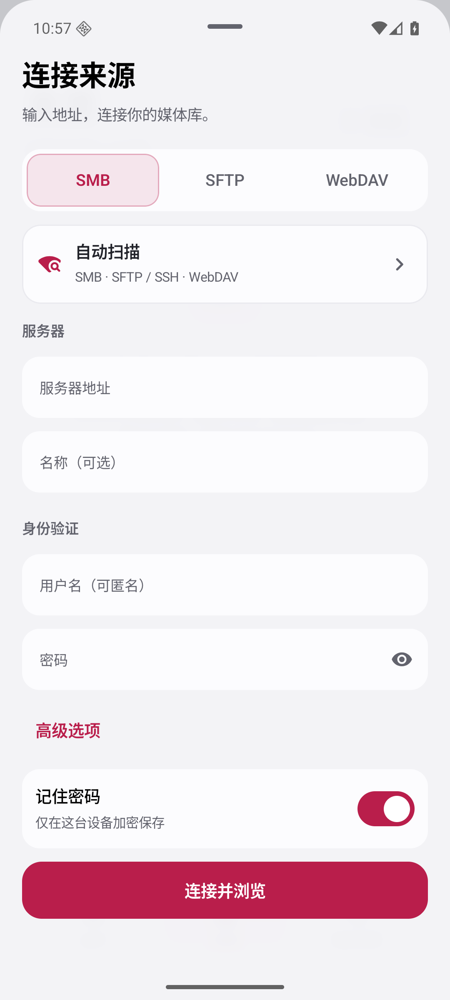
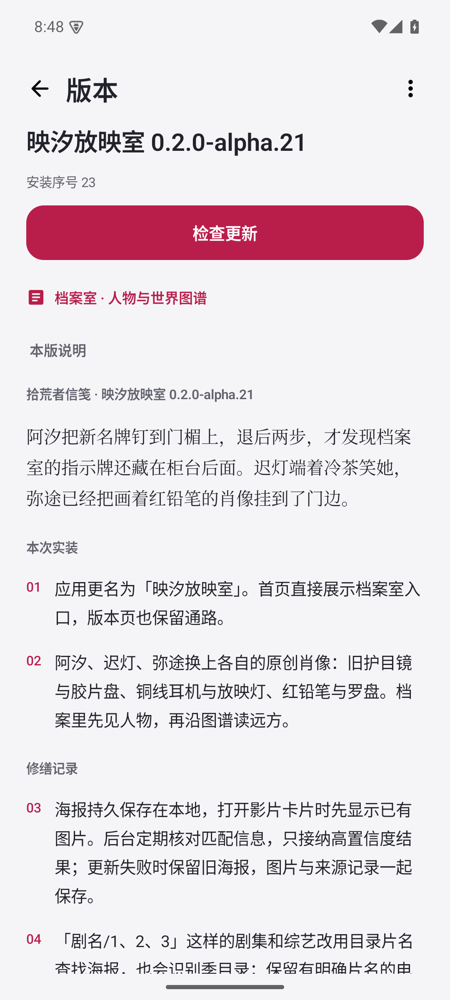
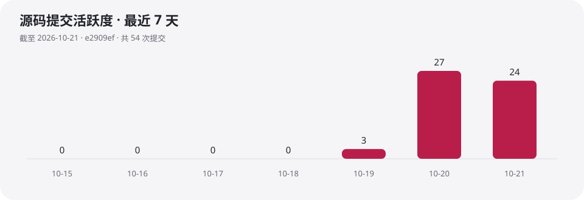

  

<h1 align="center">映汐放映站 · Yingxi Station</h1>

长潮退去之后，总有一些影像值得带回放映室。

<strong>一款简洁的 Android 本地与局域网视频播放器。</strong> 打开文件、连上自己的媒体库，然后安心看完一部片子。

  <a href="https://github.com/RoyalLiang/Yingxi-Studio/releases/download/v0.2.0-alpha.64/yingxi-0.2.0-alpha.64-66.apk">下载 arm64 安装包</a> ·
  <a href="https://github.com/RoyalLiang/Yingxi-Studio/releases/tag/v0.2.0-alpha.64">阅读版本信笺</a> ·
  <a href="docs/player-controls.md">播放与操作</a> ·
  <a href="https://github.com/RoyalLiang/Yingxi-Studio/issues">反馈问题</a>

  
  

## 先把影片放到手边

- **从自己的媒体库开始**：系统文件与文件夹、SMB、SFTP、WebDAV、阿里云盘官方接入。
- **离开之后，再接着看**：最近拾荒、断点续播、同目录队列与选集，配合来源收藏和分组。
- **把播放留给画面**：沉浸全屏、手势控制、关键帧预览、倍速、音轨和字幕；支持画中画与后台音频。
- **给片架补上封面**：优先读取目录海报，再查询公开海报；没有内嵌字幕时可按影片指纹匹配中文字幕。

  
  
  

截图来自应用实际运行界面，展示来源入口、固定更新操作与放映站人物档案。

## 三步开始放映

1. 在 Android 15 / 16 手机上安装上方正式签名 APK。
2. 从**来源**打开本机文件夹、添加服务器，或进入独立的**搜寻附近据点**。网盘接入位于 WebDAV 页的接入方式中。
3. 连接并验证来源后选择影片；下次可从最近拾荒继续。

住民档案可从**放映站 → 档案室**直接进入，点选阿汐、迟灯、弥途阅读档案与语录；底部**探索**承载章节来信、地点图谱，以及「旧片匣归位」「调频寻声」「路标对读」三项离线练习。

新版本可以在**站务 → 信笺**检查。顶部可随时检查更新，当前信笺在下方独立滚动；核对安装包后交给 Android 系统安装会话，由你确认覆盖安装。

目录与剧集可以登记进**封存柜**，从公共列表收起；设备身份验证后从柜中查看，退到后台重新锁定。它不移动或加密原文件。设置页分别记录安装包和缓存占用。

## 按设备架构安装

每个 APK 只含一种 CPU 架构。新版应用按 Android 提供的兼容 ABI 顺序选择更新，影片分辨率、码率和色彩处理保持原样。

| 架构 | 安装包 |
| --- | --- |
| arm64-v8a | [arm64](https://github.com/RoyalLiang/Yingxi-Studio/releases/download/v0.2.0-alpha.64/yingxi-0.2.0-alpha.64-66.apk) |
| armeabi-v7a | [armv7](https://github.com/RoyalLiang/Yingxi-Studio/releases/download/v0.2.0-alpha.64/yingxi-0.2.0-alpha.64-66-armeabi-v7a.apk) |
| x86_64 | [x86_64](https://github.com/RoyalLiang/Yingxi-Studio/releases/download/v0.2.0-alpha.64/yingxi-0.2.0-alpha.64-66-x86_64.apk) |
| x86 | [x86](https://github.com/RoyalLiang/Yingxi-Studio/releases/download/v0.2.0-alpha.64/yingxi-0.2.0-alpha.64-66-x86.apk) |

原有文件名用于 arm64 接续更新。alpha.33 及更早的 32 位 ARM 或 x86 客户端需要从上表手动选择一次，此后可自动选择适配包。没有通用架构包。

## 媒体库接入能力

| 方式 | 接入与浏览 | 自动发现 | 播放与续播 |
|---|---|---|---|
| 本机文件与文件夹 | Android 系统授权 | 系统选择器 | 支持 |
| SMB | 匿名或账户，共享目录 | SMB 服务广播；可补充查找端口候选 | 支持 |
| SFTP | 账户与主机密钥核验 | SFTP / SSH 服务广播；可补充查找端口候选 | 支持 |
| WebDAV | HTTP / HTTPS、NAS 与 OpenList | WebDAV 广播及声明 DAV 能力的 HTTP / HTTPS 广播 | 支持 |
| 阿里云盘 | 官方授权接入 | 手动授权 | 支持 |

自动发现只列候选；连接成功后才能浏览影片。未广播的服务可以手动输入地址，普通网页不会直接当作 WebDAV 媒体库。

海报、字幕的匹配方式、来源和开关见[海报与字幕](docs/media-enrichment.md)。播放格式取决于设备可用的解码器。

播放器显示视频记录的真实码率；点击码率可手动选择片源已有且可播放的视频轨道或清晰度档位。单一视频轨道只有一档，不会生成转码档位。

## 放映站最近在忙什么

图表按项目 Git 历史生成，是注明截止提交的快照，随发版更新。[原始统计数据](docs/project-metrics.json)可核对每日提交数。功能支持以本页矩阵和对应文档为准，不把活跃度当作性能指标。

## 一封来自放映站的信

影像拾荒者负责把散落的影片带回片架，把失灵的路标修好。每次发版留下一封短笺：这次搬来了什么、修好了哪里，偶尔也记下柜台边的一点小事。

首页日记内的「档案室」可以阅读阿汐、迟灯、弥途的档案、语录与据点大事记；底部「探索」提供章节来信、地点图谱和三项离线练习。图谱实线记下往返信路，虚线保留尚未证实的传闻。人物、关系和信笺有共同档案，后续发版按真实改动续写。

世界观让更新记录有一条连续的线；操作仍然直白，影片、来源、搜寻附近据点和下载始终使用真实名称。读[世界观与信笺写法](docs/worldbook.md)、[世界观名词表](docs/world-glossary.md)、[统计总览](docs/world-statistics.md)和[应用架构映射](docs/world-integration.md)，或直接去看一部片子。

## 参与修缮

使用 Kotlin、Jetpack Compose 与 Media3 实现，以 IINA 的产品理念为参考，遵循 Android 的权限、系统文件选择与安装流程。

- [工程与数据规则](CONTRIBUTING.md)
- [文件导航](docs/file-navigation.md) · [来源设置](docs/network-settings.md)
- [云盘接入](docs/cloud-integrations.md) · [版本与发布](docs/releasing.md)
- [第三方许可资料](third_party)

本项目按 [GNU GPLv3](LICENSE) 发布，完整对应源码随每个版本提供；第三方依赖保留各自许可与 NOTICE。IINA 用作产品参考，未复用其图标。
