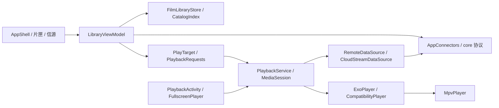

# 架构与代码地图

本图依据 Beta.2 源码组织，供定位使用。修改前读取实际符号与调用方；启用 CodeGraph 的本地仓库先查询索引，索引故障时使用有界源码搜索。

## 模块职责

| 范围 | 拥有者与入口 | 维护约束 |
| --- | --- | --- |
| Android 导航和状态 | `MainActivity` → `AppShell` → `LibraryViewModel`；本机浏览由 `LocalFilesViewModel` 管理 | 页面返回、取消和来源切换不能被过期结果覆盖 |
| 片匣与资料 | `FilmLibraryScreen`、`FilmLibraryStore`、`CatalogIndex`、`CatalogIdentity` | 稳定影片/版本/位置标识，进度、札记与放映单关联需保留 |
| 来源与访问 | `SourceStore`、`SourceOrganization`、`SourceRoot`、`AppConnectors`、`PrivateSourceAccess` | 根目录、认证来源、封存与本机别名是实际访问边界 |
| 播放会话 | `PlaybackActivity`、`PlaybackService`、`PlaybackRequests`、`PlaybackQueue` | 单一 MediaSession；请求与生命周期一致 |
| 播放画面 | `FullscreenPlayer`、`PortraitPlaybackControls`、`PlaybackOrientationProbe`、`PreviewFrames` | 打开/缓冲期间控件可达，方向与首帧依据媒体证据 |
| 后端切换 | `PlaybackRenderers`、`CompatibilityPlayer`、`MpvPlayer`、`third_party/mpv-bridge/` | 硬件优先；释放旧输出、接管进度与轨道，串行执行 native 调用 |
| 协议核心 | `core/src/main/kotlin/io/localplayer/core/`：SMB、SFTP、WebDAV、云盘、随机读取与缓存 | 取消、读取偏移/长度、版本一致性、重定向与身份验证 |
| 轨道与补充资料 | `PreparingSidecarSource`、`MutableSubtitleSource`、媒体补充模块 | 取消过期工作，同目录匹配与线上隐私规则分别执行 |
| 设置与迁移 | `PlaybackPreferences`、`HistoryStore`、`FilmLibraryStore` | 恢复前完整校验，失败保留数据，不迁移凭据和目录授权 |
| 世界数据与阅读 | `world_atlas.json` → `StationWorld` / `StationChapters` | 双语、稳定标识、采用状态与证据状态分开 |
| 更新与回执 | `UpdateDownloadService`、`UpdateInstallReceiver`、`PlaybackReportSubmission` | 签名与摘要校验；主动同意和真实回执 |
| 官网 | `website/public/`、`website/functions/api/`、`website/tools/` | 受限上报、内容同步、独立部署证据 |
| iOS 留存 | `ios/Sources/Core/`、`ios/Sources/App/` | 与 Android 能力和验证分开，发布暂停 |

## 主要数据流

完整包路径分别为 [`app/src/main/java/io/localplayer/app/`](../../app/src/main/java/io/localplayer/app/)、[`core/src/main/kotlin/io/localplayer/core/`](../../core/src/main/kotlin/io/localplayer/core/)。图只表达职责联系，不表示所有调用同步执行。

native 调用、输出销毁、外挂轨道与缩略图 IO 的已有取舍见[播放 IO 决策](../adr-playback-io-20261027.md)。不要在文档整理中另造通用播放器接口或共享跨平台层。
