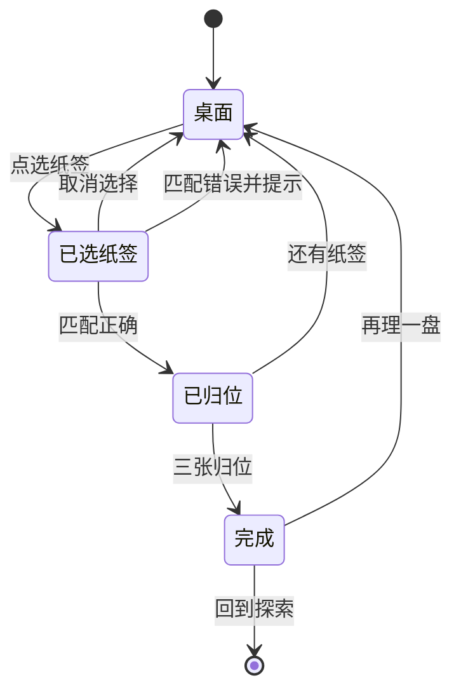

# 探索交互玩法提案

状态：待采用，未实现。适用基线：alpha.47。前三项界面整理随本版发布；本文件只设计后续探索玩法，不宣称应用已具有这些玩法。

先做“旧片匣归位”。它把阿汐整理片架的日常变成一轮可点选的小练习，能直接复用现有人物、片匣和纸签。建议随后加入“调频寻声”，再将地图上的已知记录做成“路标对读”。

## 一页看懂三个玩法

| 顺序 | 玩法 | 用户实际做什么 | 一轮设计目标 | 得到的反馈 |
| --- | --- | --- | --- | --- |
| 1 | 旧片匣归位 | 把三张虚构纸签配回三只练习片匣 | 20–40 秒，无倒计时 | 纸签贴合，阿汐留一句手写评语 |
| 2 | 调频寻声 | 调节旋钮或按步进键，让两条信号线重合 | 15–30 秒，可随时退出 | 噪点渐静，显出一则已有短笺 |
| 3 | 路标对读 | 对照两张记录，辨认“已核”和“待核” | 20–45 秒，无扣分 | 显示依据及原文入口，保留地图的证据边界 |

以上时长是设计目标，尚无用户实测。三项均可离线游玩，随时退出，不要求连续签到或观看广告，不占据播放、选集和续播入口。

## 首轮先做旧片匣归位

入口放在探索页地图之前，保留现有章节入口的位置。只放一个“帮阿汐理片匣”的主要操作，避免同时堆三张玩法卡。

1. 进入后，桌上有三只练习片匣和三张纸签，纸签使用既有地点、物件与角色日常。界面明确标“练习片匣”，不读取用户的影片名、海报或历史。
2. 用户先点纸签再点片匣即可配对；拖放作为附加操作，不能成为唯一方式。已选纸签同时改变边框、文字状态和读屏播报。
3. 配错时纸签回到原处，显示一条具体提示，例如“再对照一下纸脊上的片号”。不震动惩罚、不扣分、不清空已配好的两张。
4. 三张归位后，片匣轻轻合拢，阿汐留一句与当前练习有关的评语。提供“再理一盘”和“回到探索”，不弹出强制领取奖励页。
5. 中途离开保留本盘的纸签位置；再次进入可继续，也可主动“重新摆放”。正确答案不会因退出而改变。

首批可先准备六盘人工编写并审校的题面，每盘固定稳定 ID、中英文、引用词条及提示。首批数量是待采用的内容计划。完成反馈只证明完成练习，不表示修复真实磁盘、获得物资或推进章节。

### 试做时怎样判断是否可用

- 在 320dp 宽、1.8 倍字号下，三只片匣和当前纸签都可通过滚动访问，文字不挤在拖动区域里。
- 点选和拖放能完成相同任务；读屏用户可依次选择纸签、目标与取消操作。
- 退出、切后台和重开应用后能恢复同盘状态；换语言不重置匹配结果。
- 已配对的纸签不会被误操作覆盖；重置必须由用户主动触发。
- 系统关闭动画时直接切换摆放状态；练习不播放语音，播放中的影片不被打断。
- 本地只保存题面 ID、对应内容版本、匹配位置和是否完成；题面更新不兼容时说明该盘已更新，允许重开。无需账号或网络。

## 第二步再做调频寻声

用已有放映站的信号意象做一段可操作的练习。用户转动旋钮，或点“低一点 / 高一点”，令两条线逐渐靠近。靠近时噪点减弱，合上后显示一则随包已有短笺，并可打开对应人物档案。

- 信号是游戏生成的图形，不扫描无线电、蓝牙或附近设备，不暗示发现真实远端来源。
- 声音默认关闭，可选择极轻的合成噪声；开始播放影片、收到音频焦点变化或离开探索时立即停声。
- 同时用线条位置、数值与文字说明接近程度，不要求“听力辨别”或只靠颜色过关。
- 没有等待解锁或失败倒计时。用户可以直接查看提示或阅读短笺；小游戏不成为阅读内容的门槛。
- 短笺只从现有已审内容中取用，随机出场不揭晓新身份、未知能力或第三章情节。

## 最后做路标对读

地图点选后，可选择“对读两张记录”。每轮提供现有词条中的两段材料，请用户把记录放入“已核”或“待核”。给出反馈时显示原文、记录身份与引用入口，允许改选，不设置排名。

遇到尚无结论的内容，答案就是“待核”。游戏完成不会把虚线画成实线，不替角色完成实际勘察，不把观看历史伪装为地理路线。地图与章节的正式确认状态仍来自随包世界书；玩家的练习记录单独保存。

## 视觉与动效沿用现有界面

沿用暖纸、松绿与莓色，以及现有圆角、字体和人物肖像。桌面只使用片匣、纸签和手写记号，反馈靠纸签贴合与一次合拢表达。触点至少保留平台建议的操作范围，大字号下允许布局增高。不要用长转场、闪屏、全屏粒子或连续震动奖励完成操作。

## 采用前仍需决定的事项

采用哪一项、首批题面与文字需要用户确认。本提案推荐先做旧片匣归位；后两项不随首轮实现一并启动。任何积分、连续签到、物资、付费、剧情解锁或新章节都不在本提案的首轮范围，后续另行提出。

## 交互依据

- 点击范围以 48dp 为目标；视觉元素可以更紧凑，但需验证扩展触区不与其他操作重叠，参照 [Android Compose 默认无障碍行为](https://developer.android.com/develop/ui/compose/accessibility/api-defaults)。
- 拖放之外提供“点纸签、点片匣”的完整等价操作，参照 [W3C 对拖动操作替代方式的说明](https://www.w3.org/WAI/WCAG22/Understanding/dragging-movements.html)。
