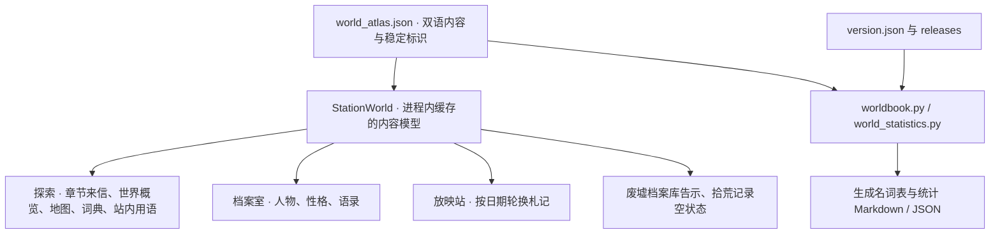

# 世界观如何进入映汐放映站

本轮以当前 alpha.36 应用为基线，融合本地 `3d4d2d8` 中的世界观材料。用户于 2026-10-22 明确采用新设定；这次采用记录随 alpha.37 数据发布，不改写旧版信笺或发布历史。

## 内容与实现共用一份来源



这是 `app` 模块内部的内容边界，不另建播放器或网络模块。`StationWorld.load` 只缓存双语数据，不保存 Activity，也不缓存当前语言。界面按 `LocalConfiguration` 选择文字；札记的日期轮换沿用本机日期。新增内容不依赖网络。

章节阅读位置继续由 `ChapterReading` 存入 `station-reading-v1`，按章节独立保存；人物和地点继续使用稳定标识。目录授权、连接认证、文件读写和 Media3 播放仍由各自现有模块负责，故事数据不调用这些能力。

## 每个入口承载什么

| 当前入口或状态 | 随包内容 | 实际功能与边界 |
| --- | --- | --- |
| 放映站 · 拾荒者日记 | `dailyLines` | 18 则中英札记按日期轮换，不表示真实发生了联网、交易或奖励 |
| 档案室 | `characters` | 肖像、性格、可点按切换的语录与进度 |
| 探索 · 章节来信 | `chapters` | 保留第一、二章与各自阅读位置 |
| 探索 · 站内档案概览 | 数据集合的实时计数、`canonAdoption.note` | 解释作者采用与站内核验的区别，不手写另一份计数 |
| 探索 · 废土图谱 | `nodes`、`edges` | 6 地点、5 联系；实线代表已核信路，虚线代表位置或路线待核，可点按阅读详情，远灯图上短标注保留全称详情与读屏 |
| 探索 · 废土词典 | `lexicon` | 正式设定、站内传闻、未采用提案分别说明；不是任务、能力或奖励树 |
| 探索 · 站内用语 | `appNames` | 可展开的 17 项入口与真实功能对照，不更换已采用的废土名称 |
| 废墟档案库根目录 | `surfaceNotes.local_archive` | 阿汐的本机影像告示；授权和浏览不移动或重命名原文件 |
| 拾荒记录空状态 | `surfaceNotes.history_empty` | 迟灯的值夜寄语；实际播放才产生记录，操作按钮可滚动到达 |
| 全屏缓冲 | 现有播放器状态 | 保留单一「信号破译中」状态及缓冲无障碍说明；材料中的额外角色气泡不恢复 |
| 信笺 | 当前版本的 `releases` 文件 | 应用与 Release 共用实际变更说明；图谱版本足迹只是选录，不充当发布清单 |

远程入口继续使用「避难所」总称，按「幸存者据点」与「外部信号塔」登记；「信源」管理分册，「路标」保存常用位置。「放映室」可指站内房间，应用品牌统一为「映汐放映站」。「外部避难所」「更新柜台」等历史措辞不替换当前入口。

## 正式存在与走通过的路分别记录

`canonStatus` 表示作者采用，`status` 表示词条的站内证据。地图的 `known` 表示地点或路线核验，不等同于作者是否创造了该地点。例如理想城的净水环、能源塔与贸易已经正式采用，但弥途尚未走通的路线仍画虚线。第二章寄信人与所述设备情况继续未知，不借新物种设定提前揭晓。

本轮精绘三位人物与变种人工匠、觉醒者、孢子蛾的日常联系；描边核爆—长潮的因果、菌膜保护范围与感知能力边界；填充片罐侧签、收到消息先登记和未寄回条的工作细节。人物的族群、身世与觉醒状态保持留白。

## 校正原材料的统计口径

完整结果由[统计页](world-statistics.md)与[统计 JSON](world-statistics.json)生成。下表用于解释合并范围，不代表重新发布 alpha.32。

| 项目 | 当前基线 alpha.36 | 融合后 alpha.37 |
| --- | ---: | ---: |
| 地点 / 联系 | 5 / 4 | 6 / 5 |
| 人物 / 性格侧写 | 3 / 0 | 3 / 3 |
| 角色语录 | 23 | 30（阿汐 12、迟灯 12、弥途 6） |
| 词典条目 | 24 | 28 |
| 日期轮换札记 | 6 则中文 | 18 则双语 |
| 版本足迹 | 8 | 16 |
| 章节 / 可阅读记录 | 2 / 4 | 2 / 4 |
| 站内用语 | 17 | 17（新增应用展示） |

原材料的 8 个风物词条和 26 条语录来自另一份本地 alpha.32 扩展稿；当前主线已经包含更完整的词典和不同语录。本次按标识与正文去重合并，保留已发布内容，不用旧数字覆盖当前数据。日记里「循光水鸟」校正为「循波水鸟」，与无线电迁徙设定及英文含义一致。

统计只计仓库中实际存在的信笺文件，带署名的信笺不等于图谱语录数量；它不宣称所有文件都已在 GitHub 发布。`atlasSha256` 绑定数据内容，便于复核，验证与设备证据留在交付记录中。

## 更新与核验

先改随包 JSON 与世界书，再运行：

```sh
python3 -B scripts/worldbook.py --write-glossary --write-statistics
python3 -B scripts/worldbook.py
python3 -B -m unittest discover -s scripts -p 'test_world*.py'
```

内容检查覆盖双语、引用、稳定标识、确认层级和生成文档漂移；Android 回归覆盖人物语录、地图、词典、站内用语、双语札记与章节阅读。内容脚本通过不等于应用已安装或真机验证，具体结果以本轮交付证据为准。
