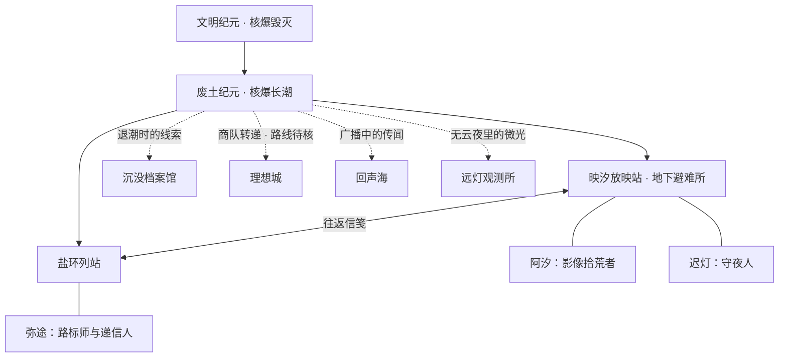

# 映汐放映站：世界观与信笺写法

文明纪元（繁荣纪元）因核爆毁灭，随后的长潮淹没旧城。幸存者在废土纪元重建生活，深层避难所、幸存者据点、聚落与理想城形成不同的生活边界。映汐放映站收存硬盘、声轨与胶片，让旧世界的影像继续被看见。

本文件维护故事边界和写作约定。[名词表](world-glossary.md)、[统计页](world-statistics.md)与应用探索页共用随包图谱；[世界观与应用映射](world-integration.md)说明内容如何进入当前架构。故事不改变播放器的账户、协议、权限或解码能力。

## 正式设定、站内证据与演进提案

2026-10-21 确认纪元、核爆起源、多种聚居形态和生命概念；2026-10-22 用户进一步明确采用本次材料中的地下放映站、核爆引发长潮、孢子利用辐射与电磁信号、觉醒者感知频段、理想城建设与贸易等细节。下文取代此前相同主题的未定描述，其他留白继续保留。

- **正式设定**：作者已采用的世界事实，以词条 `canonStatus=confirmed` 表示。理想城和沉没档案馆等地点可以正式存在。
- **站内证据**：角色掌握的信息。`nodes.known`、`edges.known` 决定地图实线与虚线；词条 `status=rumor` 表示站内传闻。正式存在的地点仍可能没有可供旅行者使用的实测路线。
- **演进提案**：词条 `proposal` 只记录尚未采用的扩展，例如共同历法、能力代价与更多制度细节。
- **未知**：阿汐、迟灯、弥途的族群、身世与觉醒状态；第二章寄信人、纸条所述设备的实际情况。不得借日常语录补定。

## 纪元与核爆长潮

| 名词 | 正式设定 | 保留的留白 |
| --- | --- | --- |
| 文明纪元 | 核爆前的文明，留下服务器、磁盘、胶片与旧铁路 | 年代、地域差异、技术全貌 |
| 核爆毁灭 | 毁灭文明纪元，触发后续地质与气候剧变 | 战争参与者、核爆次数、精确事件年表 |
| 长潮 | 核爆后地质与气候变化导致的漫长海侵，淹没旧城并重塑海岸 | 各地涨退潮时序、持续年数、精确海岸线 |
| 核爆长潮 | 对核爆与随后的长潮这一灾变链的合称 | 不把每次普通涨潮等同于新一轮核爆 |
| 废土纪元 | 核后重建的当下，多种聚居与生命形态共存 | 元年、距今年数、共同历法 |

「核爆」和「长潮」分别描述起始灾难与后续环境过程，二者有因果关系。「旧世界」「旧纪元」在当前语境指文明纪元及其遗存，不另增纪元。局部辐射雨、潮汐与风带不意味着地表全面安全或永久危险。

## 聚居、生态与能力边界

避难所深埋地底，少与外界往来，内部保留繁荣纪元的尖端技术。映汐放映站位于旧铁路终点，由旧避难所外围改建为地下幸存者据点，与深层避难所分别理解。普通聚居少于100户称据点，100户及以上称聚落；它们围绕停运列站、盐原高地和净水井重建生活。人类、变种人工匠与觉醒者共同生活。理想城围绕残存能源塔与环状净水工程重建，通过盐环商队以修配零件换取旧纪元纪录片；贸易往来不等于弥途已经亲自走通全程。

变异水鸟循无线电波迁徙，孢子蛾趋光，盐原驮兽参与运输；这些已出现的温顺生物不代表所有变异物种都温顺。自进化孢子是潮湿废墟中的共生荧光菌群，利用残余辐射与微弱电磁信号迭代；密封胶片盒外的透气菌膜隔绝潮水与盐雾。菌膜保护已有密封盒，不意味着整片废墟无辐射或任意磁盘可被修复。

变种人是核后发生体格异变的幸存者后裔，在聚落承担铁匠、搬运、向导等工作；职业不是族群的唯一归宿。觉醒者是感官适应电磁异变与旧纪元神经残留的人类分支，能够捕捉频段与磁场偏转，协助迟灯滤除广播杂音、辨认受损音轨。感知不自动恢复缺失数据，能力上限、代价与「神经残留」的具体机制仍可提案。

## 人物与日常衔接

| 人物 | 正式采用的联系 | 保留的未知 |
| --- | --- | --- |
| 阿汐 | 地下放映站的拾荒者、登记人，与聚落变种人搬运工打捞磁盘，接收理想城修配件 | 族群、身世、觉醒状态 |
| 迟灯 | 留灯守夜、维修旧机器，与路过的觉醒者校准广播，提灯边停着孢子蛾 | 年龄经历、族群、特殊能力 |
| 弥途 | 盐环列站递信人，与变种人向导结伴，辨认兽群与孢子生态线索；未走过的路画虚线 | 理想城实测路线、完整行程、族群与能力 |

本轮细化片罐侧签与未寄回条的日常：收到消息先登记，核实后才补路线。阿汐的利落、迟灯的耐心、弥途的谨慎分别体现在性格侧写、语录与札记中；不会用来替角色揭晓身世。

## 地图与路线

| 地点 | 世界事实 | 放映站掌握的证据 |
| --- | --- | --- |
| 映汐放映站 | 旧铁路终点的地下避难所，阿汐和迟灯驻守 | 已知 |
| 盐环列站 | 盐壳包围的停运列车聚落，弥途常驻 | 已知，与放映站有实测往返信路 |
| 沉没档案馆 | 沉入回声海的资料库，孢子菌膜包裹密封胶片盒 | 地点与可走路线尚待站内核验 |
| 理想城 | 能源塔、净水环与商队贸易形成的秩序城邦 | 来件和转述可登记，完整位置与路线未实测 |
| 回声海 | 长潮形成的辐射内海，水鸟循波，旧频段仍有回响 | 广播可听见，地图位置与海上路线待核 |
| 远灯观测所 | 北脊山后的高地中继信标，与觉醒者观测相联系 | 晴夜信号记录与传闻，尚未到访 |

地图有两处已知地点、四处位置或路线待核地点；实线仅代表放映站—盐环列站，另外四条联系用虚线。北脊山、旧城和旧铁路线是背景，不重复计为节点。动态计数见[统计页](world-statistics.md)，不在世界书中维护另一份版本数字。

## 对照材料后的矛盾处理

- 「映汐放映室」作为应用旧称停止使用；「地下放映室」仍可指站内的具体房间。
- 「外部避难所」等过时产品分类以当前「幸存者据点」「外部信号塔」为准；世界实体与连接功能分别解释。
- 新材料的 alpha.32 数字是历史来源，不代表当前发布状态；本次合并保留 alpha.35 第二章和 alpha.36 信源优化。
- 角色语录中的亲历、收到的物资和听来的消息不等于新路线验证。理想城贸易已确认，弥途的实测承诺保持不变。
- 地图已采用的世界事实与站内证据分别标注；旧版「生命机制未定」的描述以本轮正式采用内容为准。
- 第一、二章保留原标识与阅读位置；不新增解锁、奖励或等待机制。

## 固定设定

- **映汐放映站**：应用的叙事落点，也是保存影像、整理片架和递送更新信笺的地方。
- **影像拾荒者**：记录实际改动的叙述者。说话像修理设备的人，具体、克制，偶尔带一点轻松的生活细节。
- **片架**：影片与最近播放。**路标**：来源和目录导航。**柜台**：版本、更新与下载入口。真实功能名首次出现时必须写清。
- **信笺**：每次版本更新的记录。世界观随版本逐步展开。故事可以描绘远方的废土地理与人物，但必须与已经开放的产品能力明确区分；未知路线标为传闻，不用故事宣称功能已经实装。

用户提供的《废土OL》公告用于学习结构和节奏：实装清单明确，优化紧跟其后，偶尔留下一处鲜活细节。映汐不沿用原作的人物、地名、势力、剧情、经济数值或玩家人数。

## 版本说明的固定写法

文件标题和中英分区沿用发版格式。中文正文以“【拾荒者信笺】”或放映站来信开场，随后按本次改动选择“【本次实装】”“【修缮记录】”，结尾可以留一句“【放映站手记】”。英文写成自然的 field letter，传达相同事实。

1. 开场一两句，交代这次在修什么。不要用大段故事挡住更新内容。
2. 实装与修缮使用短条目或编号清单。每条先说真实功能变化，再放一个贴合动作的意象。
3. 大改动和小修补都必须来自本次提交；没有大功能时直接写修缮记录。
4. 生活细节要与这次改动有关，例如柜台灯、信箱或重新排齐的路标。一版一处即可，不反复堆“废土、星尘、文明残响”等空泛意象。
5. 不使用“修复少量 BUG”“更多内容自行探索”代替改动事实；不虚构玩家数字、性能提升或未完成能力。
6. 不加入“验证与限制”“测试结果”“已知限制”、CI 日志、校验和、提交 SHA 或设备验收声明。技术证据写入 CI 与交付记录。

世界观用于让文案有延续性，不会改变来源权限、网络访问、文件位置或播放行为。自动发现、连接验证、手动添加等名称始终准确区分。

## 人物与世界图谱（第一章）

应用随包携带的 `app/src/main/res/raw/world_atlas.json` 是人物、地点、语录与版本足迹的共同来源。从 alpha.21 起，人物采用原创绘画肖像：阿汐的异色护目镜、胶片盘与红围巾，迟灯的铜线耳机、放映灯与搪瓷杯，弥途的红铅笔、地图与罗盘。首页直接显示「档案室」入口，版本页仍保留入口；先见人物，再展开图谱，不占据播放界面。肖像位于 drawable-nodpi/portrait_*.webp，由 imagegen 为本项目生成，应用内以原生 Image 呈现；切换人物有交叉过渡。

- **阿汐 / Axi**：影像拾荒者，也是先前匿名信笺的记录者。旧风镜、错配螺丝、修理时的碎碎念；克制但不冷漠，优先把事情说清。
- **迟灯 / Chideng**：已有信笺里的守夜人。修过三次的耳机与总会放凉的茶；语速慢，关心设备，也关心从远处回来的人。
- **弥途 / Mitu**：盐环路标师和递信人。红铅笔别在短发间，把未走过的路画成虚线；说话短，拒绝把猜测当成事实。

图中地理是原创叙事，不是联网来源、产品路线图或开放功能承诺。第一章只确认放映站与盐环之间有往返，其他地点保留未解线索。后续每次更新只推进与当版改动有呼应的一小步，保持一个广阔世界尚未说尽的余地。

## 给发版 agent 的写作约定

### 长潮废土的用词与口吻（alpha.31 起）

- 写信的人是在废土据点修设备、理旧档案的拾荒者。用朴素的动作与实物落笔：检修、接线、登记、门牌、路标、旧磁盘、放映机、工作灯。磨损和修补来自具体动作，不靠堆叠「温柔、光影、旅程、丝滑」等修饰词营造气氛。
- 先写实际改动，再放一处有来由的据点细节。功能清单允许写「放映机修缮、更新柜台、档案归位」，随后必须说清设备解码、更新操作、目录等真实行为。界面按钮继续使用真实名称。
- 不把不同事物硬换成世界观名词：数字安装包仍是安装包，下载仍是下载，不写「下载胶片、搬运胶片、把断点装订进信封」；信笺是更新说明，片架是媒体入口，探索是章节来信、地点图谱与足迹，档案室是人物、性格与语录。
- 不写现代营销标语、空泛的抒情修饰或未经发生的灾难、敌人、物资奖励。人物动作与对白只放末尾，沿用图谱中已存在的身份和关系。中英文都遵守相同的物件含义和克制口吻。
- 这些规则约束新版本，不重写已经发布的信笺。

1. 先读本文件和本版实际 diff，再读图谱。选一个与真实改动有关系的人物视角；阿汐可以记录，迟灯可以谈播放与守夜，弥途可以谈路标与送达。
2. 先交代具体功能与使用后的变化，人物动作或一句短语录仅在信笺末尾自然出现。不是每版都增加角色，也不为凑数强塞台词。
3. 引语使用 Markdown `> 语录 —— 人名`，英文独立自然翻译。说话者必须在图谱中有档案；新增人物时同时补齐中英档案、肖像类型、关系和语录。
4. 改变人物关系或揭开新地点时，同步更新 JSON、上面的 Mermaid 关系图和 `chronicles` 版本足迹；已发布信笺不改写。不要把旧版本生活细节扩写成从未出现过的既成事实。
5. 每版说明仍是一份中英信笺，供应用内与 GitHub Release 共用。故事与修缮记录相互呼应，但不遮住按钮名称，不虚构测试结果、功能、提升比例或剧情参与人数。
6. 运行 `python3 -B scripts/worldbook.py` 与 `python3 -B scripts/release_notes.py`。图谱验证关系端点和双语完整性，信笺校验语气、内容结构及引用的人物。

## 门牌与档案入口（alpha.21）

应用名称为「映汐放映站」；故事中的放映站仍是一处有来信与归人的地点。人物识别以随包原创肖像和 JSON 描述为准，保留护目镜、修补耳机和红铅笔三种独有标记。首页档案入口与版本页通向同一份档案，不另建一套人物设定。

## 废土避难所肖像（alpha.23）

人物造型采用地下避难所拾荒者的实用逻辑：回收布料拼接的灰绿工装、修补护具、呼吸防护、旧工具和搬运装备。背景是混凝土、重型隔离门、通风与供电设施；冷色顶灯与少量工作灯共同照明。材质磨损应对应使用痕迹，装备应能说明人物靠什么工作和生存。

- 阿汐保留异色护目镜，增加拼装头灯、撬拆工具和胶片罐，突出影像搜集与拆解。
- 迟灯保留灰白鬓角与修补耳机，使用维修围裙、表笔、钳子和带护网的拼装工作灯，突出供电与放映设备维护。
- 弥途保留红铅笔、橙色肩带、地图和罗盘，以短雨披、回收背架、绳索与水壶表现外勤寻路和携行。

三张图由内置 imagegen 结合旧肖像重绘，保持面部身份、职业与已有世界关系；不新增未经信笺铺垫的地点或势力。发布时同时检查首页小头像、档案室圆形头像与大幅肖像的辨识度。

## 据点日常（alpha.26）

首页日记使用「相伴第 N 天」，从应用首次安装日期计天，不是废土纪年，也不增加启动等待；短句按当天日期稳定选择。角色问候每天首次进入时出现，关闭后不再显示问候或等待时的角色短句。

「今日拾获」只登记用户实际浏览目录时新遇到的影片，首次发现时间不随刷新改变；已有播放记录迁移时保留原来的时间。它不是对服务器全盘扫描的承诺。

阿汐负责接待与登记，迟灯负责放映与设备修理，弥途负责来源路标。WebDAV 连接入口使用「外部避难所」，协议与认证字段保留真实名称。本机入口使用「废墟档案库 / 本机影像」，分类与季集标记只帮助浏览，不能替代路径、文件身份和真实片名。

播放缓冲时居中显示胶片／信号标识与「信号破译中」，保留「正在缓冲」的无障碍说明；这不是文件修复或觉醒能力。当前播放界面仅保留单一缓冲状态，不再展示额外角色气泡；相关语录可在档案室阅读。

「头灯亮度（屏幕亮度）」与「通讯器音量（媒体音量）」用于解释手势，仍控制真实亮度和媒体音量。快进、快退的轻提示音为可选项，默认关闭，遵从系统音效设置。

## 信笺末尾的人物声音

从 alpha.25 起，更新条目只列播放器、导航、画面与交互等真实功能变化。人物形象、性格、肖像或关系的更新不写入改动清单，也不在开场宣布。若本版需要人物声音，只在两种语言各自的信笺末尾，以一两句符合固定设定的署名人物语录自然收束；不要求每版增加人物，不用语录承诺功能。人物资料和图谱仍在档案室维护。

## 档案阅读排版（alpha.27）

首页管理员语录单独排版，常规字号在可用宽度内选择 11.5–13sp；超过字号下限仍无法放入单行或使用系统大字号时自然换行，保持可读性。档案室选择头像为 64dp 圆形光圈，姓名独立显示，详情插图上限为 160dp。

## 第二章落地与阅读边界（alpha.35）

用户在 2026-10-22 明确要求第二章开始落地，取代此前“仅保留方案”的约束。第一章「灯还亮着」与第二章「有人回信」同时提供手动入口，不以安装天数、播放任务、自动解锁或奖励推进。第一章保留回看；各章以稳定章节 ID 与信件 ID 分别记住最近读到的一封。返回应用可恢复所选章节与信件，不承诺恢复信件内部的像素滚动位置。

第二章使用 `chapter_02`，依次呈现弥途的「夹在片罐里的折纸」、阿汐的「未署名，也留一个位置」、迟灯的「先把这盏灯稳住」。弥途从既有的盐环列站带回未署名回信；阿汐把“收到”与“证实”分栏，沿用片罐侧签；迟灯收起按尺寸串好的垫圈，写下尚未送出的回条。这些细节衔接已有三人的职业与物件，不确立新势力或能力。

已发生的是发现、带回、登记与写回条。寄信人、所称上次影像的来源、远处灯与声音的真实状况仍是未知或信中陈述。回条尚未送出，不增加实线或虚线边，不确认理想城路线，不自动核实远方地点或扩展生命能力；生命机制按本轮正式采用的定义维护。`reply_fragment` 是新物件词条，明示上述边界。

章节正文提供中英对照。人物档案、地图与词典为共用资料区，正文与共用资料分开；不为阅读增加观影等待，播放主线与章节选择独立。

## 入口用语与材质（alpha.29）

远程媒体入口统一称为「避难所」，目录页、连接页、设置、提示和读屏标签沿用相同叫法；WebDAV 仍保留「外部避难所」标题。本机仍称「废墟档案库」。海报的资料来源与版权出处继续使用准确的「来源」，协议、认证和路径保持原名。

页面以暖纸底色、莓红操作色与深绿告示牌衔接现有角色肖像；日记和路标说明带胶片齿孔，避免只换名词。标题「映汐」「放映站」同行共用基线，「放映站」保留 13sp。

## 探索与登记反馈（alpha.30）

底部导航新增独立「探索」，先呈现已有第一章的人物来信、地点图谱和据点大事记，保留所选人物与阅读状态。alpha.35 将第一、二章的手动选择、旧章回看与分章信件位置落实到应用，不把使用时长或播放任务变成解锁门槛。

建议后续以可独立阅读的地点短笺和角色来信逐步扩充，内容准备好才展示新章入口。探索与观影主线并行，提示低频，不为了剧情增加播放等待。

alpha.31 时第二章仍为提案；alpha.35 已明确授权落地。当前探索承载章节来信、地点图谱、词典与据点足迹；档案室承载住民档案、性格与语录。章节阅读位置由 ChapterReading 分章保存。

日常目录读取只更新今日拾获；成功添加避难所或授权本机目录才给出一次登记气泡。气泡贴近页面下部、避开底部导航，以小头像、短句与透明材质承接现有反馈，不在每次浏览中占据顶部视线。

## 应用用语保留废土风格并说明含义

| 应用名称 | 当前含义与说明 |
| --- | --- |
| 映汐放映站 | 品牌名；故事据点仍称映汐放映站 |
| 避难所 | 远程媒体入口；页面说明为远程片库，不证明存在故事中的物理据点 |
| 幸存者据点 / 外部信号塔 | 两个独立连接入口：前者 SMB/SFTP，后者网盘/WebDAV；协议名和认证字段保留原名 |
| 废墟档案库 / 本机影像 | 本机影像浏览；与人物档案区分 |
| 档案室 · 住民档案 | 角色、个人介绍、语录与据点大事记；不承担本机文件浏览 |
| 探索 / 废土图谱 | 第一、二章来信，地点、联系与词典；大事记移至档案室 |
| 废土词典 | 随包中英名词表；已确认设定、传闻与演进提案分别标示 |
| 据点大事记 | 按应用版本选录的叙事足迹；不是完整版本史、世界纪年或使用足迹 |
| 拾荒者日记 · 相伴第 N 天 | 本地安装后的相伴天数，不参与章节解锁 |
| 今日拾获 | 实际浏览目录时新记录的媒体，不代表移动文件、全盘扫描或物资掉落 |
| 信号破译中（读屏：正在缓冲） | 真实播放缓冲状态，不代表修复文件或故事能力 |
| 头灯亮度 / 通讯器音量 | 手势说明同时保留「屏幕亮度」「媒体音量」的真实含义 |

后续修改名称时，连同导航、操作提示、错误恢复和读屏标签一起核对。来源和版权出处继续使用准确的「来源」，协议、认证、路径和安装包保持原名。

## 片罐侧签与封存边界（alpha.33）

阿汐给磨花的旧片罐补写侧签：标签放在罐身，盖子磨损后仍能辨认名字。这条站内日常进入她的中英档案语录，并补入放映站词条。它沿用阿汐整理影像、迟灯照看设备的分工，不确立新的建筑、制度、能力或向外路线；第一章地点和信路不变。

应用里的「封存柜」是目录与剧集的私密登记入口，使用设备身份验证。封存项从公共片架、历史及今日拾获收起；只有从柜中验证后才能查看，退到后台重新落锁，正在播放的封存影像停止。此功能不移动或加密原文件，不改变文件提供方或服务器权限；不自动向在线海报与字幕服务发送封存项名称。相关系统身份验证、协议和错误含义保持清楚，不用世界观暗示加密保障。

来源根目录是导航边界：普通浏览、面包屑、返回和旧快捷入口不能越过所选目录；只有明确重新选择根目录时才查看外层。幸存者据点与外部信号塔是应用连接分类，不因此新增故事地点。档案室入口合入日记，人物与据点大事记留在档案室，探索保留章节来信、地点与词典。alpha.35 已按最新推荐表采纳称谓；旧札记候选数量不代表当前提供数量。

## 检修盘里的垫圈（alpha.34）

迟灯把检修拆下的垫圈按尺寸串在细铁丝上，避免混用；这条短笺进入中英文档案语录与放映站词条，承接已有的旧设备修理分工。它是站内物件与工作习惯的细节，不建立新的技术能力、制度或地点。现有第一章与路线确认层级不变。

绘画资源转为无损 WebP，原尺寸、RGBA 像素、透明度与 ICC 保持一致，不重绘人物、工具或环境。转码清单记录旧资源摘要和像素摘要，供独立复核。角色形象和原作叙事不因文件格式改变。alpha.35 已采纳本轮最新称谓，实际札记以随包内容为准。

## 统一门牌、称谓与札记（alpha.35）

应用名统一为「映汐放映站」，与故事据点共用名称。Android 应用标签、首页、版本页、更新通知、安装提示及现有 iOS 名牌一并对齐；包名、存储标识和远端仓库地址不因品牌文字变化而迁移。历史已发布信笺保持原样。

本轮采纳称谓对照表全部推荐项：放映站、拾荒记录／最近拾荒、继续放映、站务、信笺、路标、信源／信源、搜寻附近据点、据点路标／中继路标、通行凭据、线路设置。来源设置与名称按据点／信号塔显示；连接删除改为“移除登记”。字段使用“分册名称”“未归册”。全量双语定义与稳定标识以随包 `appNames` 为准，生成至[名词表](world-glossary.md)，审校结果见[称谓核查](wasteland-copy-audit-2026-10-22.md)。

路标在应用中指连接或目录入口；分册是其分组方式，不是新地理或社会制度。路标不代表收藏影片或下载文件。移除登记不删除原文件。附近搜寻结果仍只是候选；凭据校验、服务器指纹核验、系统私密验证保持不同含义。地址、协议、密码、权限、下载、安装等具体字段与操作保留准确名称。

值班札记的阿汐头像下方只显示姓名，职务仍留在人物档案。档案室设在札记底部整行入口，与正文和人物身份分开。底部胶片齿孔以一次轻缓扫光入场后停稳，系统关闭动画时静止呈现。角色信纸的提示改为“轻触信纸，读下一句”，与仅轮换文字的实际行为一致。

最新推荐表中“拾荒记录”与“今日拾获”分工不同：前者记录实际观看与续播，后者记录实际浏览目录中新发现的影像。“路标”作为筛选名称指已收藏入口，“信源”是分册管理入口；具体名称与双语释义以随包 appNames 为准。章节阅读入口设在探索，档案室仍先展示人物与语录。

## 登记簿的夹页（alpha.36）

既有日常细节：阿汐将磨软的厚纸裁成登记簿夹页，用短棉线系住书脊，翻查来信时不容易散落。她会叮嘱值班的人：「登记簿的夹页别抽走。两边的来信各有去处，回头才找得到。」这延展了既有登记工作，不新增据点、制度或通信能力。

随包中英短笺归入阿汐的档案室语录，夹页细节同步到词典 `station`。应用里的幸存者据点与外部信号塔仍只是连接分类：它们在添加避难所的同一弹层内分别选择协议、保留各自填写内容；保存后的来源独立配置。它们不是新增故事地点，也不暗示能自动接通远端。

本轮仅补充既有登记工作的日常，沿用当前章节内容；该轮未变更长潮成因；随后 alpha.37 按用户确认采用核爆长潮机制，角色族群与觉醒状态继续留白。

## 检修架后的松线（alpha.38）

迟灯会在检修架后留一截松线，再用旧皮带收住余线，避免换接头时扯动整排设备。这是既有修理分工中的日常细节，归入 `chideng` 的双语语录、`station` 的词典记录与版本足迹 `0.2.0-alpha.38`；不新增技术能力、路线或制度。短笺是「线盘别缠死。留一截松线，下次检修才不必把整架拆开。」

本轮沿用已采用的核爆长潮与共生设定，保留当前章节及阅读位置。故事里的线盘不解释或承诺联网速度；应用中的 SMB/SFTP 有界读取和等待诊断只描述真实功能，不暗示角色能力能接通服务器或改变影片质量。

## 检修纸上的暗灯（alpha.39）

迟灯会先在检修纸上画出灭掉的指示灯，记下等待时长，再标出待查的接头。这是既有设备修理分工中的工作习惯，归入 `0.2.0-alpha.39`；纸上的观察与推测分开，不确立新的设备能力、制度或路线。中英文短笺与放映站词条同步进入现有档案室。

## 夹在一起的片匣纸条（alpha.40）

阿汐把同一片匣的登记纸和检修纸夹在一起，迟灯翻查时沿用同一份记录。这延续阿汐整理档案、迟灯维护设备的已有分工，归入 `0.2.0-alpha.40`；中英文短笺、放映站词条与版本足迹同步。不新增制度、路线、技术能力或章节。

## 路牌与登记簿（alpha.41）

阿汐重写片架旁的路牌，只在上面留下找路所需的字；迟灯把取下的附记夹回登记簿，按片匣次序收好，来客需要细查时再翻。站内既有工作日常自然展开，不建立新的制度、地点或能力。阿汐的中英语录与本轮足迹进入随包档案；地图实虚线的含义仍由图例承载，设定边界继续保留在世界书与数据中。

应用称谓：菜单入口称「信源」（Sources）；添加信源中的两类仍各自独立，分别为「幸存者据点」（Survivor outpost，SMB／SFTP）与「信号塔」（Signal tower，WebDAV／网盘）。「地下避难所」仍是世界中的聚居形态，不能被全局替换成媒体来源。新版本信笺采用站内修缮的动作和物件表达真实变化，不把实现参数、协议术语堆进日常叙述；历史已发布信笺保留。

开屏采用用户选定的 B「信号归站」：两路线条与站徽是品牌动效，不表示网络已连接。沿用 Android 系统开屏退出层，首次从桌面启动时播放，可轻触略过；系统关闭动画、页面恢复或回到应用时直接交接内容。

## 进片口旁的旧胶片（alpha.42）

迟灯在进片口旁夹着一截退役胶片，用来试齿轮咬合与片带松紧；阿汐擦净来件上的湿砂，再把片匣到站时刻抄进登记簿。他们把晚到的片匣与不亮的灯分开记，免得送片迟滞时反复拆动仍能工作的机器。属于既有修理与登记日常的细化，不建立新设备能力或运输制度。

迟灯中英语录同步进入档案室可轮换的语录卡，与本版足迹关联。此处「送片迟滞」是故事内的日常记录；应用中的下载通道提示、实测吞吐与账号配额仍按真实接口证据解释，不能用叙事断言网络限速、自动修复或原画已恢复。文明/废土纪元基础及长潮、生命机制和第二章的确认层级保持原状。

## 检修纸的空栏（待随包发布）

稳定关联：人物 `chideng`（迟灯）、`axi`（阿汐），地点与词条 `station`（映汐放映站）。迟灯用空片罐压住检修纸的一角，只有片轮实走一格，才在纸上落一笔；纸张被风吹响，不能记成胶片送达。停住的空栏先留着，阿汐把已经看见的动作与尚待核对的原因分开登记。

这是既有放映与登记分工中的日常细节，不增加技术能力、制度、身世、路线或章节。双语短笺进入 `characters.quotes`，地点日常进入 `lexicon.station.summary`，由现有档案室和废土词典承载；词典由随包图谱生成。

> 迟灯：纸响不算片子到了。先看片轮走了几格，再把那一格记上。
>
> Chideng: Rustling paper does not mean the reel has arrived. Watch how far the reel turns, then mark only what moved.

本增量于 alpha.43 随包收录，并在同版浅铁盘日常中登记版本足迹，不补写或改写旧信笺。检修日常不能解释网络慢速的原因、承诺提速，或为播放器增加等待。三阶段产品建议中的电台、回收站与新增模式仍是规划讨论，未因本条日常而落地。

## 浅铁盘上的片号（alpha.43）

既有据点日常：迟灯（`chideng`）在映汐放映站（`station`）把胶片分放在几只浅铁盘里，每盘边缘都夹着同一片匣的片号；缺号的空处先留白，交给阿汐（`axi`）继续核对。并排整理不改变胶片先后，也不意味着缺失内容能凭空修复。

双语语录、`station` 词条与版本足迹 `0.2.0-alpha.43` 同步；既有角色身份、两章手动阅读、地图及解锁边界保持不变。本段是已采用框架内的日常展开，不引入新能力或制度。前轮「检修纸的空栏」也随本版首次进入安装包，历史信笺不改写。

> 迟灯：几盘可以一起理，片号得一格格对。缺的地方先留白，不能算齐了。
>
> Chideng: Sort the trays together, but check the frame numbers in order. Leave a gap where a frame is missing; do not call it complete.

「回收片段」是清理应用私有网盘缓存，不删除原片，不产生物资或能源奖励。实际并行请求、缓存命中与传输速度以读取记录为准；日常文案不承诺秒开或绕过供应商限速。

## 桌边的旧纸签（alpha.44）

- 精绘：迟灯把桌边长短不一的旧纸签裁齐，留两行写片名，零碎备注记在背面；这一日常延续放映站登记影像、维护设备的分工。
- 描边：纸签整齐只是站内物件细节，不代表新制度、缓存奖励或已核路线。札记的作者与肖像一致，应用刷新不作为故事时间推进。
- 填充：`diary_019` 是迟灯关于旧纸签的中英文短笺，与既有 `chideng`、`station` 关联，由首页札记轮换承载；站内词条与版本足迹同步。此为既有框架内的日常细节，未新增章节。词典及站内用语入口按本轮要求隐藏，资料与生成名词表仍保留。

## 片匣角上的来处（alpha.45）

- 精绘：弥途把来处写在片匣角上，与迟灯裁齐的两行纸签并排。`diary_020` 补入中英文札记池，关联既有 `mitu`、`station`，由首页札记与大事记承载。
- 描边：写下地名是记录来源，不把未知路线提升为已核；海报信源标签只是用户登记名称，格式按实际文件扩展名显示，目录不编造合计体积。「封存片架」对应目录，「封存影像」对应视频，仅收起映汐中的显示与访问，不移动、加密或公开分享原片；「放回片架」恢复普通列表中的可见性。
- 填充：片匣角记与旧纸签彼此对照，省去反复添抄来处的零碎文字。这是既有框架内的日常展开，无新制度、能力、奖励、路线或章节。

## 本轮增量：压低一格的灯罩（alpha.46）

- **精绘**：迟灯夜里把灯罩压低一格，让光留在检修纸上，经过的人不必直迎灯光；延续既有留灯守夜、照看设备的分工。双语短笺 `diary_021` 进入既有日常语录池，人物与地点身份不变。
- **描边**：「守夜人模式」是真实片库外观选择，支持跟随系统、日间与守夜，不设等待或定时解锁。「拾荒者路线图」只按本机观看记录排列足迹，不是实地地理、信源在线证明或废土地理路线的实测证据；封存内容仍由私密访问规则保护。
- **填充**：放映站词条补入灯罩、检修纸与过道的光线关系；本版足迹与双语信笺关联这条日常。不新增章节、路线、制度、能力、身世或奖励。

平台画质只列真实返回的完整播放档位；平台有多个真实完整档位或真实自适应列表时才开放自动档；只有独立档位时按实际缓冲停滞逐档降低。原画继续作为默认，转码与原画缓存各走自己的读取流程；故事中的灯光变化不代表画质、网络权益或网盘配额发生改变。

## 本轮增量：纸脊上的小片号（alpha.47）

- **精绘**：阿汐把散开的据点旧事夹回既有档案架，在纸脊添一个小片号，片匣封面保留画面。这是登记人与旧档案的日常，没有新增角色身份或制度。
- **描边**：据点大事记是档案室按应用版本选录的叙事变化，不是完整世界纪年；探索仍承载章节、地点、联系与词典。探索交互设计见[玩法提案](explore-play-proposal.md)，在 alpha.47 时三项均为待采用方案；后续采用与实装状态见下文，不引入积分、奖励或章节解锁。
- **填充**：双语札记 `diary_022`（`axi`）、放映站词条与 `0.2.0-alpha.47` 版本足迹同步进入随包图谱；词典由脚本生成。海报角标仅保留左上角白色真实格式，档案室入口随文字高度排版。
- **确认边界**：沿用既有框架的日常展开，不揭晓身世、能力或未核路线；两章阅读位置与所有播放能力不变。

## 旧片匣归位：首轮落地（alpha.48）

用户在 alpha.47 交付自查后明确采用首轮方案。探索中新增六盘离线纸签练习，分别整理工作台、片匣三面、纸签状态、小工具、纸边问题和收桌步骤。它是应用交互，不是新的废土制度、实际档案修复或章节解锁；在 alpha.48 时「调频寻声」「路标对读」仍为提案，后续采用见下节。入口、题面和阿汐评语提供中英对照，稳定 ID 为 `case_sorting_01` 至 `case_sorting_06`，首批内容版本为 1。图谱 `practiceRounds` 引用已有 `station`、`image_scavenger`、`letter_runner` 词条。

本轮日常填充 `diary_023`：阿汐在练习片匣角上画三个小点，每归位一张纸签便盖住一个；没有奖品，只有桌面逐渐腾出的空处。它细化管理员整理纸签的习惯，不确认新身世、能力或路线。应用名 `case_sorting` 明确练习与真实影片的边界。玩法只保留本盘进度，没有计分、物资或新章；既有第二章仍手动阅读。

## 调频寻声：纸上的刻线（alpha.49）

用户明确采用第二玩法，继续使用现有废土称谓与统一纸面界面。探索中两项练习共用一组入口，章节仍在前、图谱仍在后。六段图形信号取用既有短笺 `diary_019`、`diary_020`、`diary_001`、`diary_021`、`diary_017`、`diary_003`，按原作者显示并可打开对应档案。它不是无线电扫描、真实远方来讯或觉醒能力；不通过玩法证实纸条寄信人、角色族群、身世或第三章。`tuningSignals` 稳定ID与版本、引用和起止刻度由同一图谱检查器校验。

精绘与填充 `diary_024`：迟灯补深旋钮旁的刻线，听不见的人也能跟着纸上两条线调准。这细化旧设备修理师照顾使用者的小习惯，不增加新能力或制度。描边 `signal_tuning` 应用名明确离线生成图形、直接阅读和不扫描设备的边界。世界书、图谱、生成名词表与统计同步；新短笺进入现有日常轮换，练习本身使用先前已有内容。第三玩法「路标对读」仍待采用。

## alpha.50：路标对读与木板上的纸签

用户在前两项玩法完成后要求继续第三阶段，本轮采用并落地既有第三玩法「路标对读」。六组离线纸签用已有词条的原文作为依据；记录选择与阅读状态，不改写地图、故事事实或章节位置。两张纸签可逐条改选、直接看依据及往返原文；地图地点可开始对应一组，三个玩法共用探索入口组。作者已采用的地点背景不等于站内路线已核，第二章设备和寄信人、角色觉醒状态仍未知。

精绘：弥途把纸签压在同一块木板上，铅笔留给没走过的地方，延续其路标师身份与谨慎口吻。描边：练习中的「已核」只对应说法与引用依据；提案和未知均归「待核」，完成不会替角色做实际勘察。填充：`diary_025` 收录木板与鞋底的中英日常短笺，连到弥途、路标师与图谱边界；非新制度、能力或第三章。`chronicle_050` 记下练习入口，应用通过探索与既有札记轮换承载。

## 铜尺下的票根（alpha.51）

- 精绘：迟灯用一条铜尺压平同一晚的旧票根，阿汐在背面记下停片格数，按日期收拢。日常细节沿用两人的值夜与归档分工，不增加制度、能力或新地点。对应 `surfaceNotes.history_empty`，通过空记录页的值夜短笺承载，中英随包同步。
- 描边：应用顶部「拾荒路线图」继续指本机实际观看与续播记录，保留按日期的列表；不代表地理路线、信路勘测或今日拾获。底部「拾荒记录」与「最近拾荒」沿用原称谓。`appNames.history` 与放映站词条同步说明边界。
- 填充：铜尺、票根背面的格数和两人的接力记法进入站内日常；版本足迹 `chronicle_051` 记录本次修缮。封存柜改从首页「映汐放映站」文字发起设备校验，验证机制不由故事取代。

### 首次发现彩蛋：透光胶片

2026-10-23 用户看过三款动效后明确选择「透光胶片」，本版采用此交互。滑动光斑或直接读笺可翻开 `surfaceNotes.first_light` 中阿汐的中英短笺「灯还亮着」；可跳过后继续系统身份校验。返回或点空白处离开不消耗首次发现；完成或明确跳过后保存本机标记，随后点击站名直接校验。不新增章节、奖励或联网来源。以下调频与四帧方案保留为未采用提案。

1. **透光胶片**：滑动光斑找出胶片小字，翻开阿汐的隐藏短笺。提供「直接读笺」「跳过并校验」，以后直接校验。
2. **调频来信**：转动一只旋钮对准提示刻度，出现值班员短留言；静音可完成，并提供步进键与直接读笺。
3. **四帧归位**：点选交换四片胶片，将放映站剪影排齐，露出迟灯的纸条；提供文字顺序提示、直接读笺与跳过。

首次标记在用户点击「收好短笺」或明确跳过后保存；校验失败、取消或播放退出不应泄露封存项。隐藏入口与彩蛋不提供额外访问权限，不妨碍普通播放。

## 片窗旁的旧绒条（alpha.52）

- 精绘与填充：迟灯抚平片窗两侧的旧绒条，向外收起毛边，阿汐试映时核看齐整的画框。随包短笺 `diary_026`、放映站词条及版本足迹同步，中英通过现有轮换札记与词典承载。这是既有修缮分工内的日常细节，不增加人物能力、地点或制度。
- 描边：片窗的故事细节不代表应用裁切画面。竖屏初始保留完整比例，用户仍可切换铺满；收拢控件不改变来源、清晰度与解码能力。
- 本轮入口修正：连续长按首页左上方「映汐放映站」文字三秒后，直接发起既有设备身份验证；轻点、提前松手或取消手势不进入。此前「透光胶片」首次发现流程保留其原有创作记录，本轮不再将它置于封存柜入口与验证之间。无障碍长按动作使用同一验证入口。封存柜仍是本机私密登记，不增加文件加密或远端权限。
- 确认状态：三秒入口与竖屏优化为本轮用户明确要求；旧绒条为已有框架内授权的日常填充。路线、能力、身世及后续章节均保持既有留白。

## 官网预览：灯下片单的留白角

日常增量 `station_notice_corner_20261023`：精绘阿汐把片单标题朝向来人、用空片罐盖只压留白角的小动作；填充中英札记 `diary_station_notice_corner_20261023`，关联阿汐（`axi`）、映汐放映站（`station`）与旧片罐。描边：片单只是既有据点的日常纸张，阅读由来人自己决定，不增加观影等待、奖励、制度、路线证据或章节解锁。职业、身世与能力边界保持既有定义。

这是授权范围内的生活展开；图谱、生成词典与统计同步，官网通过角色短笺展示此条。应用源数据进入既有札记轮换，但本轮没有构建、安装或发布 Android / iOS，不能据此宣称已在用户设备显示。

### 官网落地：包布的罐盖边沿（2026-10-24）

在既有片单留白角的日常中，迟灯用旧布包住片罐盖沿，阿汐移开盖子时不带起纸角；细化两人修理与归档的协作。中英短笺沿用 `diary_station_notice_corner_20261023`，地点词条同步；纸张工具不增加阅读门槛、路线证据或新能力。

整合 alpha.52 时，保留该已发布版 `diary_026`（迟灯的片窗旧绒条）。此前官网分支尚未发布到应用的片单短笺使用独立稳定标识 `diary_station_notice_corner_20261023`，避免与并行发布的数字编号冲突；原文、作者与关联延续。本轮只发布官网，不据此宣称新短笺已打入 alpha.52 APK。

## 2026-10-24：分册纸脊与片窗朝向（alpha.53）

精绘与填充：阿汐重新折好松开的分册纸脊，迟灯用既有铜尺压平边沿；中英札记 `diary_028` 由现有札记轮换承载，关联 `axi`、`chideng` 与地下放映站的归档日常。描边：册名和索引只帮助寻找，改写纸签不表示搬动片罐，对应应用整理分册不移动、重命名服务器或本机原文件。这是既有框架内的生活细节，不新增机制、制度、地点或章节。

本轮明确采用的交互调整：封存柜从首页顶部左上角「映汐」文字连续长按两秒后发起既有设备验证，札记中的「映汐放映站」不再承担入口；早先三秒入口的版本足迹保留为历史。片窗进入前尽量读取宽高与旋转信息，未知时保持当前方向，由流内信息校正。电影目录只在唯一正片且无剧集标记时直播放；分册整理与信源按钮沿用片架、索引和玻璃材质的表达。

官网的包布罐盖和站内告示角独立保留。`0.2.0-alpha.53` 足迹不写入未经原片真机确认的杜比解码能力；路线、身世、觉醒状态与后续章节继续留白。

## 2026-10-24：盖沿朝里的布缝

官网自动部署配套日常增量 `diary_station_lid_seam_20261024`：精绘迟灯把片罐盖沿的旧布接缝翻向内侧，将线头压进两层布里；阿汐沿盖沿摸过一圈，再压回片单的空白角。填充中英短笺，关联迟灯（`chideng`）、阿汐（`axi`）、放映站（`station`）与既有包布罐盖；词条同步细化工具材质与协作动作。

描边与确认状态：这是已采用据点框架内的日常修理，不是新机制或制度，不增加阅读门槛、路线证据、身世或觉醒能力，也不推进后续章节。官网通过迟灯短笺呈现；应用源数据进入既有札记轮换，但本轮不构建或发布新 APK，不能把源码同步写成已在 alpha.53 用户设备展示。

## 2026-10-24：官网世界档案与图边口信

官网独立世界档案按当前图谱展开纪元因果、六处地点、生命谱系、住民日常、第一二章标题与废土词典。世界事实、站内实测、传闻、演进提案和未知分别表述，网页示意图只沿用一条实测信路与四条待核联系，不声明比例或可通行方向。

配套日常 `diary_world_route_margin_20261024` 细化弥途把理想城商队口信写在图纸边上，阿汐询问是否亲历，弥途仍保留虚线。中英短笺关联 `mitu`、`axi`、`ideal` 和 `wayfinder`，词条同步。它属于既有来信与路标分工内的日常，不确认新路线，不展开身世或后续章节；网页实际展示与应用随包源数据分开验证，本轮不发布新 APK。

## 片窗边的留白票根（alpha.54）

- 精绘与填充：迟灯把无字旧票根夹在片窗边，阿汐用它对照纸签颜色，试完收回铜尺下。日常短笺 `diary_029` 通过既有轮换札记承载，中英随包同步，不新增地点、制度、章节或人物能力。
- 描边：票根只作临时目视对照，原片罐的标记和既有记录保留；`image_scavenger` 词条同步。故事中的试映不构成原始色彩、HDR 输出或设备解码能力的证明。应用的 DV5 兼容路径是 SDR 映射，不宣称恢复原生 Dolby Vision HDR，也不修改源文件。
- 确认状态：SDR 兼容播放由用户明确采用；票根与铜尺的细节是既有值夜分工内授权的日常填充。版本足迹为 `0.2.0-alpha.54`，其他路线、能力与身世留白沿用原边界。

## 声轨纸签的两道浅折（alpha.55）

- 精绘：迟灯在声轨纸签两端各压一道浅痕，阿汐按影片编号夹回原片罐旁；取还时只展平、折回一端，把修理与归档的协作落在纸张手感和动作上。
- 填充：新增中英日常札记 `diary_030`（迟灯 `chideng`），关联阿汐 `axi`、映汐放映站 `station` 和既有 `image_scavenger` 词条；版本足迹 `0.2.0-alpha.55` 由现有探索、档案与札记轮换承载。
- 描边与确认状态：这是已采用框架内的授权日常，不建立借阅制度、身份、能力或新路线，也不推进第三章。纸签的临时取还记号不代表联网配音已取得、不同剪辑自动对齐或画面性能已获真机验收；应用只让选定附件跟随同一播放时钟。

## 未寄出的检修纸（alpha.56）

- 精绘与填充：阿汐把检修纸的空白角折起、留在手边，迟灯在横线间写下画面抖动的时刻；片罐原标记保持不变。中英日常短笺 `diary_031` 关联既有阿汐 `axi`、迟灯 `chideng` 与 `image_scavenger` 词条，经现有札记轮换承载，版本足迹为 `0.2.0-alpha.56`。
- 描边：折角只表示纸还没寄出，不构成回信、自动修复、审核制度或新信路。应用「检修回执」指本机播放快照，预览和复制均不提交；「听音频段」指音轨语言偏好，不是无线电扫描或生成配音。公开提交必须先知情并主动确认，故事不能代替此选择。
- 确认状态：这是已采用框架内授权的日常补充，不新增地点、能力、身份、制度或第三章。角色身世与觉醒状态、既有未核路线继续留白；源数据、网页、随包展示与真机验收各自留证。

## 风扇罩旁的试映纸条（alpha.57）

- 精绘：迟灯以纸角抖动对照风扇罩、片罐和架沿的响声；阿汐拂去旧罩浮灰、把铅笔放回原处，延续修理与归档的协作日常。
- 填充：中英札记 `diary_032`，作者 `chideng`，关联 `axi`、`station` 与既有 `image_scavenger`；足迹 `0.2.0-alpha.57` 随现有札记、档案室与探索入口承载。
- 描边与确认状态：已采用框架内的授权日常。纸条是观察旧器材的对照物，不确立新仪器、能力、制度或路线，不推进第三章，也不暗示任何片源已在真机流畅播放。

## 片罐纸签的两行字（alpha.58）

- 精绘：迟灯把片罐编号挪到第二行，阿汐照抄旧纸上的字；无法辨认的地方留白，延续两人的修理与归档协作。
- 填充：中英札记 `diary_033`，作者 `axi`，关联 `chideng`、`station` 和既有 `image_scavenger` 词条；版本足迹为 `0.2.0-alpha.58`，通过原有札记轮换与档案展示承载。
- 描边与确认状态：已采用框架内的授权日常。两行纸签是个人整理旧物的做法，不建立新制度、自动识字能力、翻译技术或路线，不推进新章节，也不把未知语种写成已识别。角色身世与觉醒状态继续留白。

## 本轮增量：片架前沿的短木签（alpha.59）

阿汐把磨平的短木签插回片架前沿，只写片匣短名；长来处留在登记纸中。迟灯擦拭时不必掀起整叠纸。此为既有登记、检修分工中的日常细节，归入 `0.2.0-alpha.59` 的 `diary_034`，关联阿汐、迟灯与放映站；不增加制度、能力、路线或章节。

产品映射沿用片架一词：废墟档案库里的“我的片架”是已授权本机文件夹索引，子文件夹也显示为片架；添加片架仍由 Android 文件夹授权界面完成，名称与文件留在原处。浏览页移除说明卡与权限复述，系统授权、连接错误和实际操作仍使用明确文字。短木签通过既有札记轮换展示，中英原文随包；词典的放映站条目记录相同细节。

## 检修纸右下角的留白（alpha.60）

- 精绘与填充：阿汐在检修纸右下角留下空白，迟灯把铜尺横放桌边，等有收条再记号码。双语日常短笺 `diary_report_receipt_20261026` 沿用阿汐 `axi` 与迟灯 `chideng` 的归档、修理分工，经现有札记轮换承载，版本足迹为 `0.2.0-alpha.60`（`chronicle_mobile_report_060`）。
- 描边：空白只表示尚未取得收条，收到编号只表示一张纸已送达，不推导故障已修复、已经回信或新增投递制度。应用「检修回执」的含义同步说明播放器内知情同意后主动上报；预览、复制与打开弹窗均不提交。故事中的收条不构成线上服务已经投递的技术证据。
- 确认状态：已采用框架内授权的日常细节，不新增信路、地点、角色身世、能力、奖励或第三章。随包源数据、安装展示与真实服务投递分别验证。

## 繁荣纪元之后的聚居与探索

文明纪元与繁荣纪元指同一核爆前时代。核爆毁灭了原有秩序，长潮重塑海岸；技术体系已经断层，各方仍沿各自的条件进行探索、试造与建造。

避难所深埋地下，很少与外界往来，内部保留繁荣纪元的尖端技术。映汐放映站由旧避难所外围改建为地下幸存者据点，深层避难所另有边界。少于100户的普通聚居称据点，100户及以上称聚落。

理想城以高塔为标志，是繁荣纪元技术集中保留与落地的受益者。行商往返废土贸易，废土客三五成群拾荒；掠夺者以残暴劫掠维生，太阳军团则由大型掠夺者集团汇聚，具有更军队化的编制与素养，与理想城格格不入。

取水、供电、通风、材料回收与防守相互牵连。掠夺者、变异物种、寄生负担、坏天气及旧设施失稳，都可能打断一次建设或返程。研究和改造需要消耗材料、人力与时间；路线是否已经调查，仍单独记录。

## 映汐物种胶卷

映汐物种胶卷收录二十种生命的立绘、形态、食性、栖息环境与生态联系。硬背鼠、铜耳狐和锈背犬沿食物与废弃物接近据点；盐镜蛛与纸翅螟影响仓储和纸签，走壳蟹携容器迁移，鞍缝虱随货具流动。盐唇花、返潮芦、黑帚地衣和瓷壳苔参与形成新的栖息地，潮舟兽背负附生生命，合声蛩在旧建筑的空腔里形成声群。

完整胶卷正文与立绘由官网的物种条目承载；收录形态不等于放映站已经完成目击调查。旧有回声海水鸟、逐光孢蛾、盐原驮兽和孢子共生仍属于同一生态。灯光、贸易、清理与改渠会改变局部关系，单一物种的减少可能把压力转移到别处。

## 片窗绒条背面的线头（alpha.61）

- 精绘与填充：迟灯缝回片窗旧绒条松开的角，把线头留在背面；阿汐将下一只片匣靠在桌边，给登记纸留出位置。双语短笺 `diary_felt_corner_20261027` 沿用既有修缮与归档分工，由 `chideng` 叙述，关联 `axi`、`station` 与 `image_scavenger`，经现有札记轮换承载；版本足迹为 `chronicle_player_polish_061`。
- 描边与确认状态：这是已采用框架内获授权的日常细节，延续原有片窗绒条和片匣；不增加技术能力、制度、路线真相或章节。绒条修缮不解释播放器方向判断或解码能力，札记也不构成真机播放验证。

## 片架短脚下的铜垫（2026-10-27 审查随记）

- 精绘：迟灯将片架短脚下的三层旧纸换成一片薄铜垫；阿汐把取出的纸抚平作登记纸衬页。搬空片匣后再轻推架沿，补足两人修缮时的动作与物料再用细节。
- 填充：中英札记 `diary_copper_shim_20261027`，作者 `chideng`，关联 `axi`、`station` 与已有 `image_scavenger` 分工。通过既有日常札记轮换承载，不增加入口或阅读等待。
- 描边与确认状态：既有框架内授权日常；铜垫只是一件片架修补材料，不构成新技术、职业制度或路线证据。两人的身世、族群和觉醒状态继续留白，不推进第三章。
- 同步边界：世界书、随包图谱与生成词典/统计同步；本次是审查资料分支的源码增量，不改写已发布信笺或版本足迹，不声称已安装或进入正式 APK。
