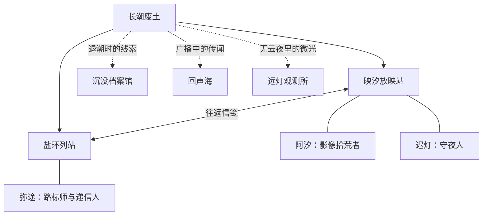

# 映汐放映室：世界观与信笺写法

核爆终结文明纪元，幸存者在废土纪元重建生活。避难所、幸存者聚落与理想城并存，辐射变异物种、自进化孢子、变种人和觉醒者共同构成尚在展开的世界。映汐放映站保存长潮之后散落的影像，让失散的人与记忆重新发生联系。

本文件规定设定边界、人物地点的衔接和信笺写法。[世界观名词表](world-glossary.md)提供中英定义与提案；应用探索页的「废土词典」读取同一份随包图谱。这里的故事不改变 Android 播放器的账户、协议、权限或播放能力。

## 按证据区分设定与提案

- **已确认设定**：用户在 2026-10-21 明确给出的纪元、核爆起源、聚居形态和生命概念，以及现有第一章已建立的人物、地点与往返信路。
- **传闻**：第一章仍未证实的故事信息。沉没档案馆、回声海和远灯观测所保留虚线，地点介绍中的人物说法不升级为实地核实。
- **演进提案**：用于后续写作的机制、制度、历史解释和剧情建议。词条的 `proposal` 与正文分开，不因写入文档或出现在词典里而自动成为既定事实。
- **未知**：尚无定论，也没有采用具体提案。包括核爆诱因、次数、范围与距今年数，长潮的完整成因，理想城的位置、数量和制度，以及三位现有角色的族群与觉醒状态。

用户本轮明确采用「理想城」这一名称。本项目保留该术语，其人物、制度、地理和剧情另行原创，不据同名作品补全事实。

## 纪元与长潮保持不同层次

| 项目 | 已确认内容 | 演进提案或留白 |
| --- | --- | --- |
| 文明纪元 | 核爆之前的旧文明时代 | 年代、技术全貌与地域差异未定 |
| 核爆断代 | 核爆毁灭文明纪元，随后进入废土纪元 | 不预设战争参与者、爆炸次数和事件年表 |
| 废土纪元 | 多种聚居形态与生命形态并存 | 元年、距今年数、共同历法未定 |
| 长潮 | 与旧城被淹、盐壳、退潮后影像遗存有关的既有潮水事件 | 可发展为断代后的区域性海侵和城市积水史；与核爆间隔及地质、气候成因未定 |

「长潮」不作为核爆的同义词；核爆也不直接解释每一处盐化、洪水和生物变化。「旧世界」「旧纪元」在当前语境中指文明纪元及其遗存，不另增一个纪元。

## 聚居与生命保持多样

避难所、幸存者聚落、理想城已确认存在。防护结构、工坊制度、城市工业能力和贸易网络仍属于逐处展开的提案。可以用能源、水、交通、维修和档案形成相互依赖；暂不把所有避难所写成地下设施，也不把理想城直接定为单一立场的势力。

辐射变异物种、自进化孢子、变种人、觉醒者是四个已确认概念，不能据此统计为四个互斥生物物种。「变种人属于人类稳定变异谱系」「觉醒是跨谱系的能力状态」均为演进提案。具体能力须有作用范围、代价和恢复条件；物种的性情、职业和立场由具体个体及群落展开。

自进化孢子的起源和能力尚未确定。不得把吸附污染物写成消除放射性，不以孢子直接证明档案馆有完好胶片，也不提前赋予觉醒者修复音轨或感知无线电的既定能力。

## 现有人物接入更大的世界

| 人物 | 已有身份与联系 | 可承接的演进方向 | 保留的未知 |
| --- | --- | --- | --- |
| 阿汐 | 影像拾荒者、据点管理员；在映汐放映站接待与登记 | 从家庭影像、地方记录和旧设备资料接触不同共同体 | 族群、身世、觉醒状态 |
| 迟灯 | 放映站守夜人、旧设备修理师；负责放映与维修 | 通过维修需求、旧设备和往来消息联系旧文明遗存 | 个人年代经历、族群、能力 |
| 弥途 | 盐环路标师、往返列站的递信人；未走过的路画虚线 | 通过递信逐步引入聚落、理想城及不同生命群体 | 理想城路线、完整行程和新向导关系 |

现有职业不自动对应阵营、种族或特殊能力。新关系需要具体档案或故事建立，不能只凭一条拟写语录视为已经发生。

## 地点衔接保留第一章边界

| 地点 | 第一章状态与既有内容 | 演进方向与边界 |
| --- | --- | --- |
| 映汐放映站 | 已知；旧铁路线上的放映与归档据点 | 可发展为公共影像档案节点；地下结构、独立维生系统与自治制度未定 |
| 盐环列站 | 已知；盐壳包住停运车厢，弥途维护路标 | 可发展为铁路聚落与递信中转地；尚无确认的理想城通路 |
| 沉没档案馆 | 传闻；退潮露顶与带回胶片盒的线索 | 内部层数、馆藏状态和孢子分布未定 |
| 回声海 | 传闻；旧城被潮水覆盖，迟灯提及异常频道 | 频道源于设备、人物、生命活动或其他原因均未揭晓 |
| 远灯观测所 | 传闻；北脊山后出现微光 | 是否有人、是否为真实设施、与其他共同体的关系未定 |
| 理想城 | 用户确认的新增城市设定，尚非图谱节点 | 坐标、距离与线路留白；不能写成弥途已带回其坐标 |

北脊山、旧城和旧铁路线是背景提及，不计为独立地图节点。当前随包数据仍为第一章、3 位人物、5 个地点、4 条联系，其中 1 条确认信路、3 条未证实线索。角色语录、版本足迹与词条数量以随包数据计算；图谱足迹是版本选录，不构成完整版本史或废土年表。

## 处理已发现的设定冲突

| 容易引起矛盾的写法 | 当前处理 |
| --- | --- |
| 「核爆长潮」把两件事混成一个名称 | 分列核爆断代与长潮，完整因果留待确认 |
| 放映站已是地下避难所 | 仅确认旧铁路放映据点；建筑类型留白 |
| 理想城坐标、商队路线已经抵达 | 保留城市存在，坐标、路线与贸易关系仍为提案 |
| 觉醒者已查明回声海最后一班列车的报站声 | 保留异常频道传闻，不提前揭谜 |
| 孢子已吸收辐射并保护胶片 | 作为尚未采用的能力构想，不写入既有事实 |
| 变种人一律强壮且从事搬运，变异动物大多温顺 | 个体与生态逐一设定，不做群体统一断言 |
| 第二章提案随文档更新自动开放 | 第二章无剧情数据、入口和解锁机制，本轮仅保存方案 |

## 固定设定

- **映汐放映站**：应用的叙事落点，也是保存影像、整理片架和递送更新信笺的地方。
- **影像拾荒者**：记录实际改动的叙述者。说话像修理设备的人，具体、克制，偶尔带一点轻松的生活细节。
- **片架**：影片与最近播放。**路标**：来源和目录导航。**柜台**：版本、更新与下载入口。真实功能名首次出现时必须写清。
- **信笺**：每次版本更新的记录。世界观随版本逐步展开。故事可以描绘远方的废土地理与人物，但必须与已经开放的产品能力明确区分；未知路线标为传闻，不用故事宣称功能已经实装。

用户提供的《废土OL》公告用于学习结构和节奏：实装清单明确，优化紧跟其后，偶尔留下一处鲜活细节。映汐不沿用原作的人物、地名、势力、剧情、经济数值或玩家人数。

## 版本说明的固定写法

文件标题和中英分区沿用发版格式。中文正文以“【拾荒者信笺】”或放映站来信开场，随后按本次改动选择“【本次实装】”“【修缮记录】”，结尾可以留一句“【放映站手记】”。英文写成自然的 field letter，传达相同事实。

1. 开场一两句，交代这次在修什么。不要用大段故事挡住更新内容。
2. 实装与修缮使用短条目或编号清单。每条先说真实功能变化，再放一个贴合动作的意象。
3. 大改动和小修补都必须来自本次提交；没有大功能时直接写修缮记录。
4. 生活细节要与这次改动有关，例如柜台灯、信箱或重新排齐的路标。一版一处即可，不反复堆“废土、星尘、文明残响”等空泛意象。
5. 不使用“修复少量 BUG”“更多内容自行探索”代替改动事实；不虚构玩家数字、性能提升或未完成能力。
6. 不加入“验证与限制”“测试结果”“已知限制”、CI 日志、校验和、提交 SHA 或设备验收声明。技术证据写入 CI 与交付记录。

世界观用于让文案有延续性，不会改变来源权限、网络访问、文件位置或播放行为。自动发现、连接验证、手动添加等名称始终准确区分。

## 人物与世界图谱（第一章）

应用随包携带的 `app/src/main/res/raw/world_atlas.json` 是人物、地点、语录与版本足迹的共同来源。从 alpha.21 起，人物采用原创绘画肖像：阿汐的异色护目镜、胶片盘与红围巾，迟灯的铜线耳机、放映灯与搪瓷杯，弥途的红铅笔、地图与罗盘。首页直接显示「档案室」入口，版本页仍保留入口；先见人物，再展开图谱，不占据播放界面。肖像位于 drawable-nodpi/portrait_*.png，由 imagegen 为本项目生成，应用内以原生 Image 呈现；切换人物有交叉过渡。

- **阿汐 / Axi**：影像拾荒者，也是先前匿名信笺的记录者。旧风镜、错配螺丝、修理时的碎碎念；克制但不冷漠，优先把事情说清。
- **迟灯 / Chideng**：已有信笺里的守夜人。修过三次的耳机与总会放凉的茶；语速慢，关心设备，也关心从远处回来的人。
- **弥途 / Mitu**：盐环路标师和递信人。红铅笔别在短发间，把未走过的路画成虚线；说话短，拒绝把猜测当成事实。

图中地理是原创叙事，不是联网来源、产品路线图或开放功能承诺。第一章只确认放映站与盐环之间有往返，其他地点保留未解线索。后续每次更新只推进与当版改动有呼应的一小步，保持一个广阔世界尚未说尽的余地。

## 给发版 agent 的写作约定

### 长潮废土的用词与口吻（alpha.31 起）

- 写信的人是在废土据点修设备、理旧档案的拾荒者。用朴素的动作与实物落笔：检修、接线、登记、门牌、路标、旧磁盘、放映机、工作灯。磨损和修补来自具体动作，不靠堆叠「温柔、光影、旅程、丝滑」等修饰词营造气氛。
- 先写实际改动，再放一处有来由的据点细节。功能清单允许写「放映机修缮、更新柜台、档案归位」，随后必须说清设备解码、更新操作、目录等真实行为。界面按钮继续使用真实名称。
- 不把不同事物硬换成世界观名词：数字安装包仍是安装包，下载仍是下载，不写「下载胶片、搬运胶片、把断点装订进信封」；信笺是更新说明，片架是媒体入口，探索是地点图谱与足迹，档案室是人物与来信。
- 不写现代营销标语、空泛的抒情修饰或未经发生的灾难、敌人、物资奖励。人物动作与对白只放末尾，沿用图谱中已存在的身份和关系。中英文都遵守相同的物件含义和克制口吻。
- 这些规则约束新版本，不重写已经发布的信笺。

1. 先读本文件和本版实际 diff，再读图谱。选一个与真实改动有关系的人物视角；阿汐可以记录，迟灯可以谈播放与守夜，弥途可以谈路标与送达。
2. 先交代具体功能与使用后的变化，人物动作或一句短语录仅在信笺末尾自然出现。不是每版都增加角色，也不为凑数强塞台词。
3. 引语使用 Markdown `> 语录 —— 人名`，英文独立自然翻译。说话者必须在图谱中有档案；新增人物时同时补齐中英档案、肖像类型、关系和语录。
4. 改变人物关系或揭开新地点时，同步更新 JSON、上面的 Mermaid 关系图和 `chronicles` 版本足迹；已发布信笺不改写。不要把旧版本生活细节扩写成从未出现过的既成事实。
5. 每版说明仍是一份中英信笺，供应用内与 GitHub Release 共用。故事与修缮记录相互呼应，但不遮住按钮名称，不虚构测试结果、功能、提升比例或剧情参与人数。
6. 运行 `python3 -B scripts/worldbook.py` 与 `python3 -B scripts/release_notes.py`。图谱验证关系端点和双语完整性，信笺校验语气、内容结构及引用的人物。

## 门牌与档案入口（alpha.21）

应用名称为「映汐放映室」；故事中的放映站仍是一处有来信与归人的地点。人物识别以随包原创肖像和 JSON 描述为准，保留护目镜、修补耳机和红铅笔三种独有标记。首页档案入口与版本页通向同一份档案，不另建一套人物设定。

## 废土避难所肖像（alpha.23）

人物造型采用地下避难所拾荒者的实用逻辑：回收布料拼接的灰绿工装、修补护具、呼吸防护、旧工具和搬运装备。背景是混凝土、重型隔离门、通风与供电设施；冷色顶灯与少量工作灯共同照明。材质磨损应对应使用痕迹，装备应能说明人物靠什么工作和生存。

- 阿汐保留异色护目镜，增加拼装头灯、撬拆工具和胶片罐，突出影像搜集与拆解。
- 迟灯保留灰白鬓角与修补耳机，使用维修围裙、表笔、钳子和带护网的拼装工作灯，突出供电与放映设备维护。
- 弥途保留红铅笔、橙色肩带、地图和罗盘，以短雨披、回收背架、绳索与水壶表现外勤寻路和携行。

三张图由内置 imagegen 结合旧肖像重绘，保持面部身份、职业与已有世界关系；不新增未经信笺铺垫的地点或势力。发布时同时检查首页小头像、档案室圆形头像与大幅肖像的辨识度。

## 据点日常（alpha.26）

首页日记使用「相伴第 N 天」，从应用首次安装日期计天，不是废土纪年，也不增加启动等待；短句按当天日期稳定选择。角色问候每天首次进入时出现，关闭后不再显示问候或等待时的角色短句。

「今日拾获」只登记用户实际浏览目录时新遇到的影片，首次发现时间不随刷新改变；已有播放记录迁移时保留原来的时间。它不是对服务器全盘扫描的承诺。

阿汐负责接待与登记，迟灯负责放映与设备修理，弥途负责来源路标。WebDAV 连接入口使用「外部避难所」，协议与认证字段保留真实名称。本机入口使用「废墟档案库 / 本机影像」，分类与季集标记只帮助浏览，不能替代路径、文件身份和真实片名。

播放缓冲时居中显示胶片／信号标识与「信号破译中」，保留「正在缓冲」的无障碍说明；这不是文件修复或觉醒能力。迟灯的气泡只在等待较久时从右侧低频出现，恢复播放、打开面板或操作手势时收起；窄屏、大字号与读屏模式不显示可选气泡。

「头灯亮度（屏幕亮度）」与「通讯器音量（媒体音量）」用于解释手势，仍控制真实亮度和媒体音量。快进、快退的轻提示音为可选项，默认关闭，遵从系统音效设置。

## 信笺末尾的人物声音

从 alpha.25 起，更新条目只列播放器、导航、画面与交互等真实功能变化。人物形象、性格、肖像或关系的更新不写入改动清单，也不在开场宣布。若本版需要人物声音，只在两种语言各自的信笺末尾，以一两句符合固定设定的署名人物语录自然收束；不要求每版增加人物，不用语录承诺功能。人物资料和图谱仍在档案室维护。

## 档案阅读排版（alpha.27）

首页管理员语录单独排版，常规字号在可用宽度内选择 11.5–13sp；超过字号下限仍无法放入单行或使用系统大字号时自然换行，保持可读性。档案室选择头像为 64dp 圆形光圈，姓名独立显示，详情插图上限为 160dp。

## 后续章节机制提案（保持方案）

当前随包图谱仅有第一章，没有自动翻页或解锁逻辑。建议第二章随完成的故事内容发布，在档案室提供章节目录及「下一章」，记住最近阅读位置，保留第一章快照供回看。章节 ID 与应用版本、播放时长、安装天数分别管理；叙事推进不会改变播放能力或来源权限。

第二章可暂定「有人回信」，以弥途从盐环列站带回的来信承接放映站的灯，延续现有三人、一条新线索和一处地点记录。本节为设计建议，尚未新增剧情、章节数据或翻页功能。可让弥途带回一封与旧设备影像有关的来信，逐步引入理想城或其他生命群体；来信内容、收信人和路线仍待定，不据此补写已发生的大事记。
## 入口用语与材质（alpha.29）

远程媒体入口统一称为「避难所」，目录页、连接页、设置、提示和读屏标签沿用相同叫法；WebDAV 仍保留「外部避难所」标题。本机仍称「废墟档案库」。海报的资料来源与版权出处继续使用准确的「来源」，协议、认证和路径保持原名。

页面以暖纸底色、莓红操作色与深绿告示牌衔接现有角色肖像；日记和路标说明带胶片齿孔，避免只换名词。标题「映汐」「放映室」同行共用基线，「放映室」保留 13sp。

## 探索与登记反馈（alpha.30）

底部导航新增独立「探索」，先呈现已有第一章的人物来信、地点图谱和据点大事记，保留所选人物与阅读状态。第二章继续保留按内容更新开放、手动进入、保留旧章回看与阅读位置的方案，不把使用时长或播放任务变成解锁门槛。

建议后续以可独立阅读的地点短笺和角色来信逐步扩充，内容准备好才展示新章入口。探索与观影主线并行，提示低频，不为了剧情增加播放等待。

从 alpha.31 起，探索专注地点图谱和据点足迹；档案室专注住民档案与来信。两处保留各自的选择与阅读位置，避免重复展示整套内容。第二章仍为提案，本次不增加章节或解锁机制。

日常目录读取只更新今日拾获；成功添加避难所或授权本机目录才给出一次登记气泡。气泡贴近页面下部、避开底部导航，以小头像、短句与透明材质承接现有反馈，不在每次浏览中占据顶部视线。

## 应用用语保留废土风格并说明含义

| 应用名称 | 当前含义与说明 |
| --- | --- |
| 映汐放映室 | 品牌名；故事据点仍称映汐放映站 |
| 避难所 | 远程媒体入口；页面说明为远程片库，不证明存在故事中的物理据点 |
| 外部避难所 | WebDAV 连接入口；协议名和认证字段保留原名 |
| 废墟档案库 / 本机影像 | 本机影像浏览；与人物档案区分 |
| 档案室 · 人物与来信 | 角色、个人介绍和语录；不承担本机文件浏览 |
| 探索 / 废土图谱 | 第一章地点、联系与据点大事记 |
| 废土词典 | 随包中英名词表；已确认设定、传闻与演进提案分别标示 |
| 据点大事记 | 按应用版本选录的叙事足迹；不是完整版本史、世界纪年或使用足迹 |
| 拾荒者日记 · 相伴第 N 天 | 本地安装后的相伴天数，不参与章节解锁 |
| 今日拾获 | 实际浏览目录时新记录的媒体，不代表移动文件、全盘扫描或物资掉落 |
| 信号破译中（读屏：正在缓冲） | 真实播放缓冲状态，不代表修复文件或故事能力 |
| 头灯亮度 / 通讯器音量 | 手势说明同时保留「屏幕亮度」「媒体音量」的真实含义 |

后续修改名称时，连同导航、操作提示、错误恢复和读屏标签一起核对。来源和版权出处继续使用准确的「来源」，协议、认证、路径和安装包保持原名。
