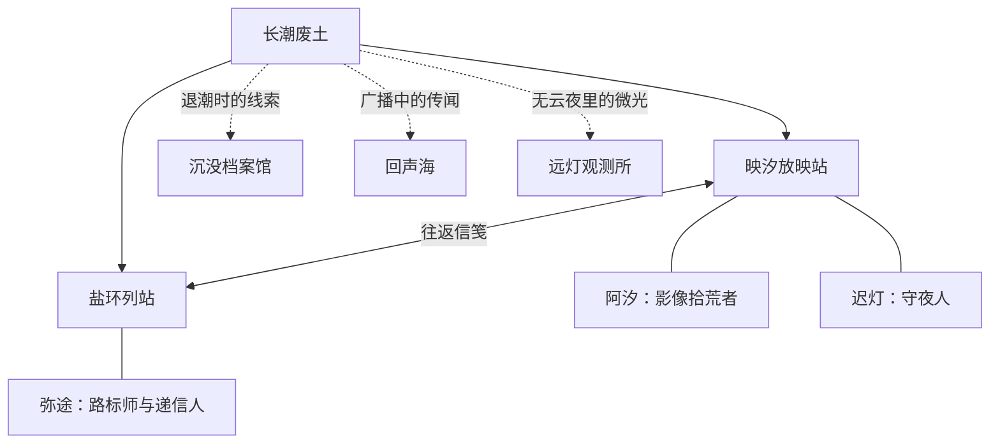

# 映汐放映室：世界观与信笺写法

映汐的产品世界观是一座长潮之后仍在工作的放映站。影像散落在旧硬盘、共享目录和云端仓库里；拾荒者把它们带回片架，修好路标、字幕与放映设备，让下一次播放仍能顺着原路开始。

这是一层轻叙事。应用仍是一款 Android 本地与局域网播放器，按钮保留真实名称，不要求用户先读故事才能操作。

## 固定设定

- **映汐放映站**：应用的叙事落点，也是保存影像、整理片架和递送更新信笺的地方。
- **影像拾荒者**：记录实际改动的叙述者。说话像修理设备的人，具体、克制，偶尔带一点轻松的生活细节。
- **片架**：影片与最近播放。**路标**：来源和目录导航。**柜台**：版本、更新与下载入口。真实功能名首次出现时必须写清。
- **信笺**：每次版本更新的记录。世界观随版本逐步展开。故事可以描绘远方的废土地理与人物，但必须与已经开放的产品能力明确区分；未知路线标为传闻，不用故事宣称功能已经实装。

用户提供的《废土OL》公告用于学习结构和节奏：实装清单明确，优化紧跟其后，偶尔留下一处鲜活细节。映汐不沿用原作的人物、地名、势力、剧情、经济数值或玩家人数。

## 版本说明的固定写法

文件标题和中英分区沿用发版格式。中文正文以“【拾荒者信笺】”或放映站来信开场，随后按本次改动选择“【本次实装】”“【修缮记录】”，结尾可以留一句“【放映站手记】”。英文写成自然的 field letter，传达相同事实。

1. 开场一两句，交代这次在修什么。不要用大段故事挡住更新内容。
2. 实装与修缮使用短条目或编号清单。每条先说真实功能变化，再放一个贴合动作的意象。
3. 大改动和小修补都必须来自本次提交；没有大功能时直接写修缮记录。
4. 生活细节要与这次改动有关，例如柜台灯、信箱或重新排齐的路标。一版一处即可，不反复堆“废土、星尘、文明残响”等空泛意象。
5. 不使用“修复少量 BUG”“更多内容自行探索”代替改动事实；不虚构玩家数字、性能提升或未完成能力。
6. 不加入“验证与限制”“测试结果”“已知限制”、CI 日志、校验和、提交 SHA 或设备验收声明。技术证据写入 CI 与交付记录。

世界观用于让文案有延续性，不会改变来源权限、网络访问、文件位置或播放行为。自动发现、连接验证、手动添加等名称始终准确区分。

## 人物与世界图谱（第一章）

应用随包携带的 `app/src/main/res/raw/world_atlas.json` 是人物、地点、语录与版本足迹的共同来源。从 alpha.21 起，人物采用原创绘画肖像：阿汐的异色护目镜、胶片盘与红围巾，迟灯的铜线耳机、放映灯与搪瓷杯，弥途的红铅笔、地图与罗盘。首页直接显示「档案室」入口，版本页仍保留入口；先见人物，再展开图谱，不占据播放界面。肖像位于 drawable-nodpi/portrait_*.png，由 imagegen 为本项目生成，应用内以原生 Image 呈现；切换人物有交叉过渡。

- **阿汐 / Axi**：影像拾荒者，也是先前匿名信笺的记录者。旧风镜、错配螺丝、修理时的碎碎念；克制但不冷漠，优先把事情说清。
- **迟灯 / Chideng**：已有信笺里的守夜人。修过三次的耳机与总会放凉的茶；语速慢，关心设备，也关心从远处回来的人。
- **弥途 / Mitu**：盐环路标师和递信人。红铅笔别在短发间，把未走过的路画成虚线；说话短，拒绝把猜测当成事实。

图中地理是原创叙事，不是联网来源、产品路线图或开放功能承诺。第一章只确认放映站与盐环之间有往返，其他地点保留未解线索。后续每次更新只推进与当版改动有呼应的一小步，保持一个广阔世界尚未说尽的余地。

## 给发版 agent 的写作约定

1. 先读本文件和本版实际 diff，再读图谱。选一个与真实改动有关系的人物视角；阿汐可以记录，迟灯可以谈播放与守夜，弥途可以谈路标与送达。
2. 先交代具体功能与使用后的变化，再在同一段落、开篇或结尾自然放入人物动作或一句短语录。不是每版都增加角色，也不为凑数强塞台词。
3. 引语使用 Markdown `> 语录 —— 人名`，英文独立自然翻译。说话者必须在图谱中有档案；新增人物时同时补齐中英档案、肖像类型、关系和语录。
4. 改变人物关系或揭开新地点时，同步更新 JSON、上面的 Mermaid 关系图和 `chronicles` 版本足迹；已发布信笺不改写。不要把旧版本生活细节扩写成从未出现过的既成事实。
5. 每版说明仍是一份中英信笺，供应用内与 GitHub Release 共用。故事与修缮记录相互呼应，但不遮住按钮名称，不虚构测试结果、功能、提升比例或剧情参与人数。
6. 运行 `python3 -B scripts/worldbook.py` 与 `python3 -B scripts/release_notes.py`。图谱验证关系端点和双语完整性，信笺校验语气、内容结构及引用的人物。

## 门牌与档案入口（alpha.21）

应用名称为「映汐放映室」；故事中的放映站仍是一处有来信与归人的地点。人物识别以随包原创肖像和 JSON 描述为准，保留护目镜、修补耳机和红铅笔三种独有标记。首页档案入口与版本页通向同一份档案，不另建一套人物设定。
